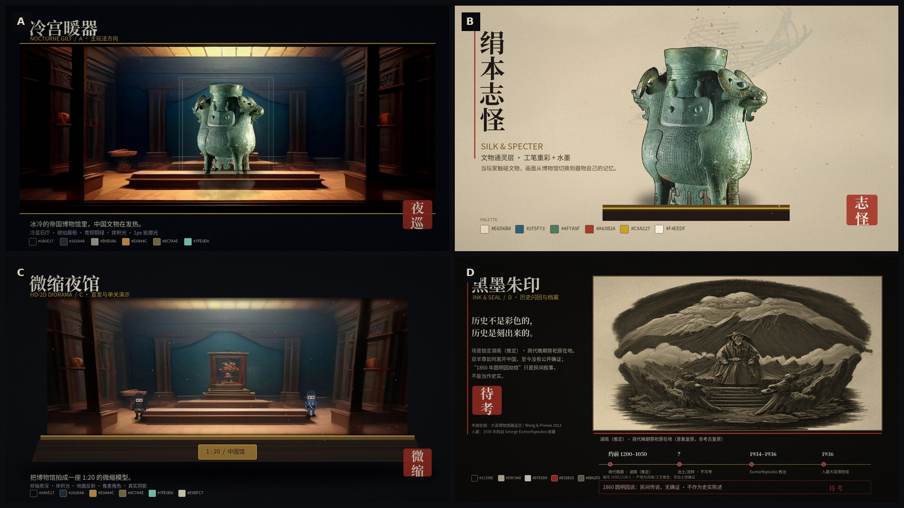
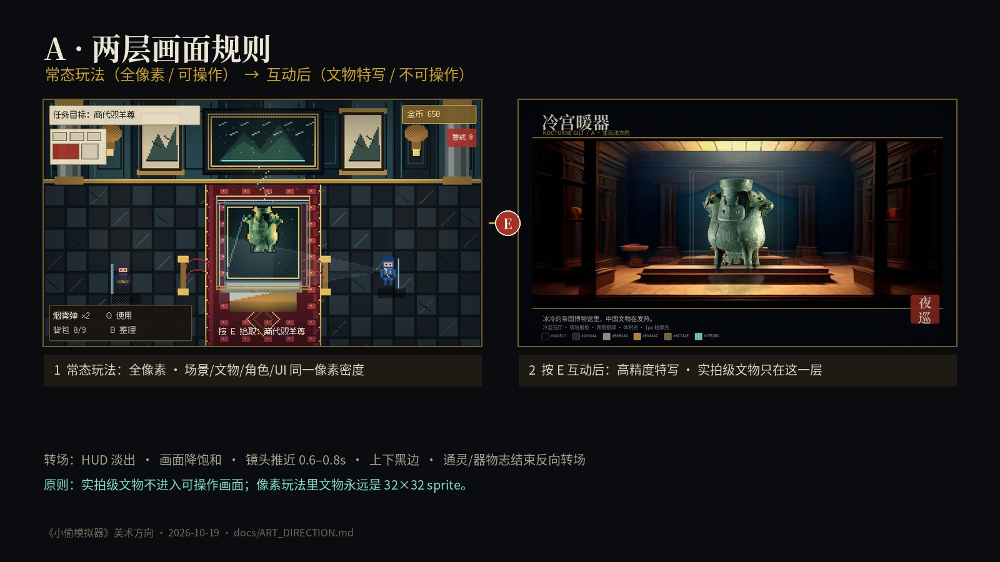
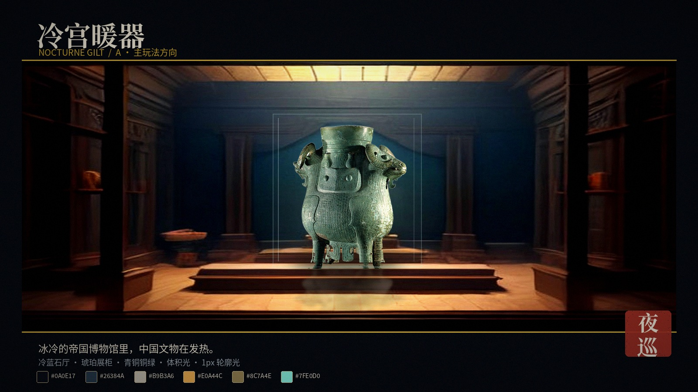
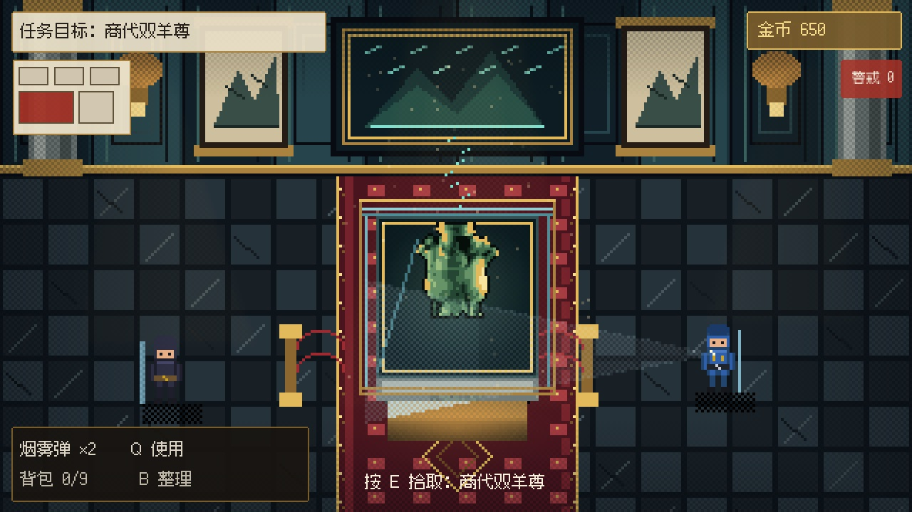
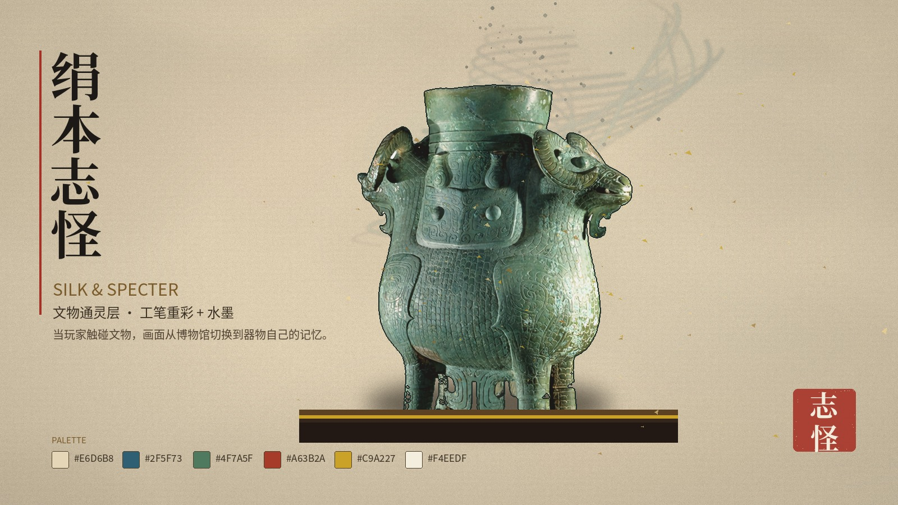
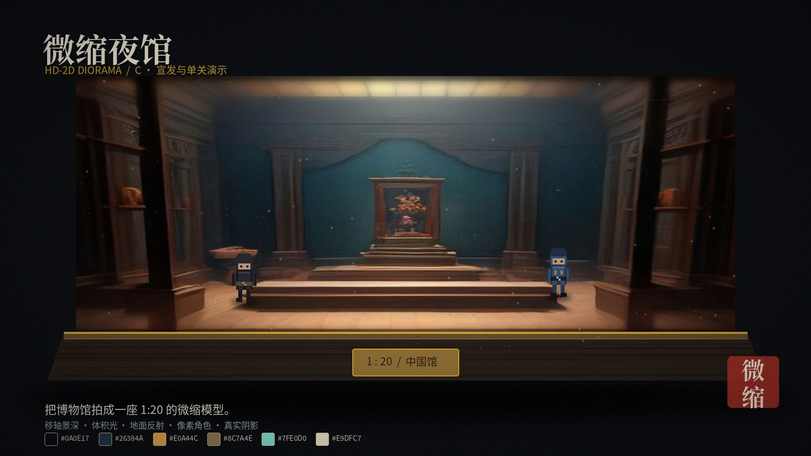
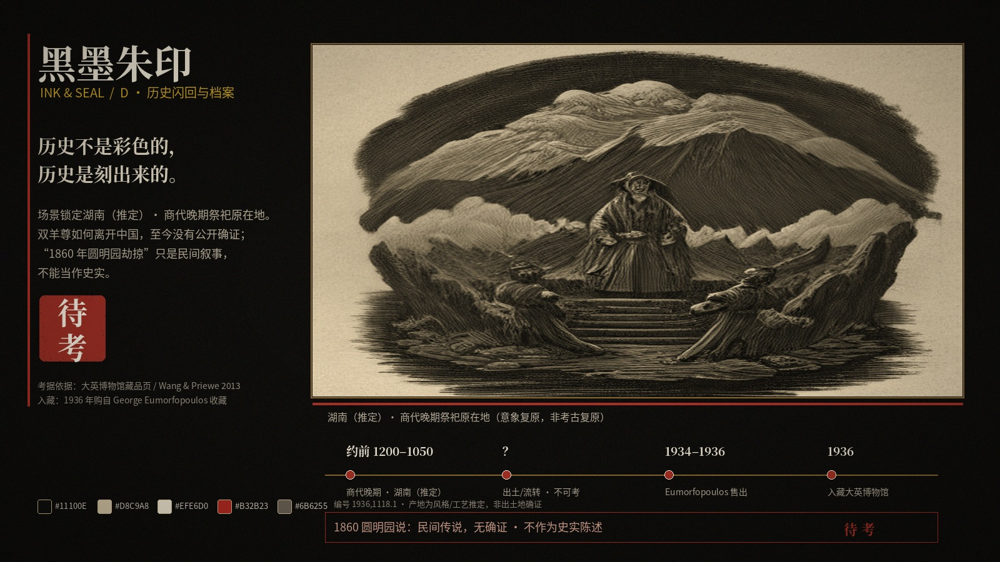
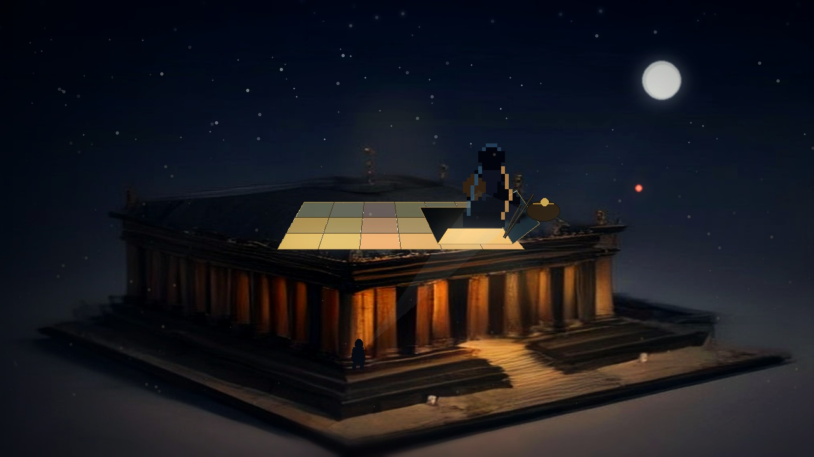
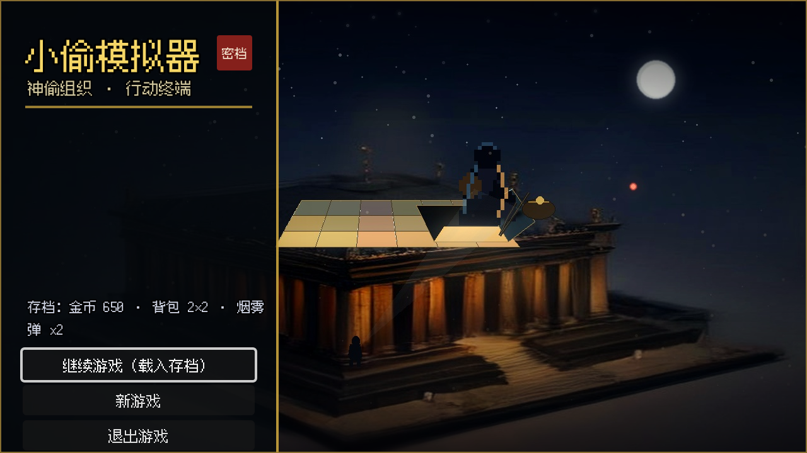
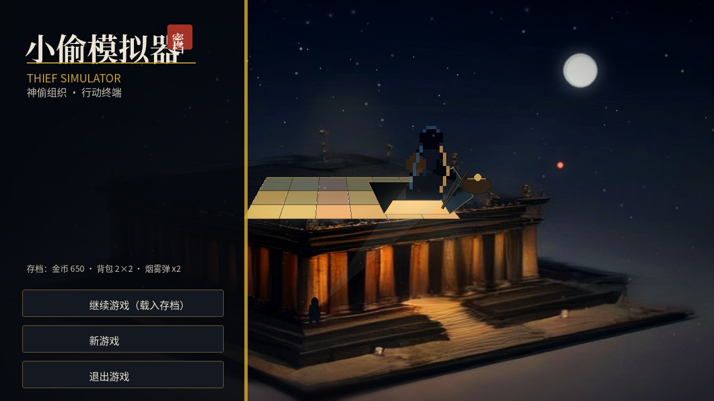

# 美术方向提案（ART DIRECTION）

> 状态：概念提案 v1 ｜ 2026-10-19 ｜ 未接入游戏
> 目的：把当前「占位可玩」提升到「截图即卖点」，同时为《小偷模拟器》建立可长期执行的美术语言。
> 配套概念图：`docs/art_direction/`（AI 生成 + 实拍文物素材 + 程序化版式合成，仅作方向参考，不直接作为游戏资产）。



> 概念图说明：A 的特写层与 C 用「场景概念图 + 实拍双羊尊」合成；A 的常态玩法预演是程序化全像素稿；B/D 是版式与画风探索。它们不是最终实机截图，也不代表最终像素精度；真正的落地标准见 §2 与 §6。
>
> 关卡落地：大英博物馆·中国馆的逐房美术规格见 `docs/BRITISH_MUSEUM_ART.md`，配套概念板 `docs/art_direction/BM_level_board.jpg`。

---

## 1. 现状诊断：为什么现在「不够精美」

当前美术不是「画得少」，而是**缺少一套统一的视觉规则**。具体表现为：

| 现象 | 根因 | 对应方向 |
| --- | --- | --- |
| 墙、地板、角色明度接近，画面糊成一片 | 没有三段明度（背景/中景/前景）与轮廓分离 | §2.2、§2.4 |
| 灯光像一块黄色贴片，没有体积 | 只有 `PointLight2D` 颜色，没有衰减、遮挡、尘埃、材质响应 | §2.3 |
| 展柜、青铜、大理石看起来像同一种塑料 | 没有材质语言表；没有高光/粗糙度/透光差异 | §2.5 |
| 房间像平面图，缺少「空间」 | 墙面/地面/道具缺少投影、接触阴影、透视收束 | §2.6 |
| 文物像图标，不像「被掠夺的国宝」 | 16×16 占位图信息量不足；没有器物特写层 | §3.B |
| UI 像调试界面 | 默认黑框 + 大字号，没有展签/档案的叙事包装 | §2.7 |
| 幽灵只是一个绿色小人 | 没有独立的「通灵视觉语言」 | §3.B |

**结论**：单纯换一套更鲜艳的调色板救不了画面。需要同时补上 **明度结构、材质、灯光、构图、UI 语言** 五件事。

---

## 2. 四套方向共用的美术基准

无论最终选哪套，以下规则都应写进项目规范。

### 2.0 两层画面规则（本次修订重点）

必须把「可操作画面」和「叙事特写」分开，否则实拍文物和像素小人一定割裂：

| 层 | 画面语言 | 资产规格 | 是否可操作 |
| --- | --- | --- | --- |
| **常态玩法** | 全像素，统一像素密度 | 16×16 瓦片、16×24 角色、**32×32 文物 sprite**；禁止实拍抠图混入 | 是 |
| **互动特写 / 通灵** | 电影感概念场景，允许高精度文物/实拍素材 | 高分辨率场景、实拍级文物、非像素 UI | 否，进入即暂停玩法 |

衔接方式：玩家在像素平面中按 E 触碰文物 → UI 淡出、画面降饱和、镜头推近 0.6–0.8 秒、上下黑边 → 进入 A 的「冷宫暖器」特写；讲述/通灵结束 → 反向转场回到像素玩法。**实拍文物只属于第二层**，因为那是「器物记忆」，不是玩家正在潜行的房间。



### 2.1 分辨率与像素密度

- 逻辑分辨率保持 **640×360**，整数倍放大；当前 2× 镜头 + 2× 窗口 = 最终 4×，不要出现 1.5×、3× 等非整数缩放。
- 场景瓦片 **16×16**；角色 **16×24**（碰撞盒约 10×6），对话头像 **32×32**；文物展示图 **32×32**，档案特写另做高分辨率插画。
- 所有像素素材关闭抗锯齿、关闭 mipmap 模糊；导入设置用 nearest。
- 字体：正文 12px（Fusion Pixel 12px），标题可另做 24px 像素字；对话正文可升到 16px，但必须保持像素网格。

### 2.2 三段明度（3-Value Rule）

每个房间强制分成三层：

1. **背景 15–25% 亮度**：墙、天花、远处展柜。
2. **中景 45–60% 亮度**：地毯、主要展台、巡逻路线。
3. **前景 70–90% 亮度或强轮廓**：玩家、警察手电、目标文物、交互提示。

玩家在暗处时用 **1px 冷色轮廓光** 把他从背景里「切」出来；不要靠把玩家整体提亮（会破坏潜行感）。

### 2.3 灯光三件套

每个重点区域至少有三层光：

| 层 | 色温 | 作用 | 实现 |
| --- | --- | --- | --- |
| Key（主光） | 2700–3000K 暖 | 照亮展品/地毯中心 | `PointLight2D` + 噪点光锥贴图，轻微呼吸 |
| Fill（补光） | 6500–8000K 冷 | 勾出墙面/大理石/玻璃边缘 | 低强度 `DirectionalLight2D` 或环境色 |
| Rim（轮廓） | 冷白/青 | 分离角色与背景 | 角色 shader 或 1px 描边贴图 |

补充：
- 光锥必须带 **软边 + 尘埃粒子 + 轻微闪烁**，不能是纯色三角形。
- 展柜玻璃要有 **边缘高光** 和 **15% 左右的透光填充**，不要整块透明。
- 文物自带 **1.5 格范围的加色光晕**，颜色随文物材质变化（青铜=金绿、玉=青白、漆器=朱红）。
- 幽灵出现时，房间整体 **降饱和 30% + 冷青偏移**，幽灵自身用加色混合，边缘带墨点/粒子。

### 2.4 轮廓与可读性

- 角色、警察、文物、交互物都要有 **1px 深色外包边**（不是纯黑，用该区域最深的色相）。
- 同类物体靠 **剪影** 区分：盗贼=兜帽+背包，警察=帽檐+手电，保安主管=长风衣+肩章。
- 任何关键交互物在 3 秒内必须能被指认：目标文物额外加「金色微粒 + 展签高光」。

### 2.5 材质语言表

| 材质 | 基色 | 高光 | 阴影 | 关键细节 |
| --- | --- | --- | --- | --- |
| 青铜 | `#6F7F5A` | `#C9B36A` | `#2E3B2E` | 铜绿斑点、铸缝、兽面纹凹凸 |
| 玉 | `#7FB7A3` | `#D8FFF0` | `#2E5F52` | 边缘透光、内部絮状纹理 |
| 大理石 | `#C9C2B6` | `#F5F1E8` | `#6E6A60` | 细 veins、磨损边角 |
| 玻璃 | `#7FA8B8` | `#E8FFFF` | `#1A2A33` | 边框高光、反射条、指纹/灰尘 |
| 丝绒 | `#7A1F2B` | `#C04A55` | `#2A0A10` | 柔软宽高光、压痕 |
| 深木 | `#6B4A2F` | `#A57A4A` | `#2E1D12` | 木纹、榫卯、包浆 |
| 纸/绢 | `#E6D6B8` | `#F4EEDF` | `#8A7A5E` | 纤维、折痕、霉点 |

### 2.6 构图与空间

- 每个房间设置一个 **Hero Object（视觉主角）**：目标文物或大型展柜，占画面 15–25%，配最强灯光。
- 地面用 **透视线/地毯边缘/地砖缝** 把视线引向 Hero Object。
- 所有角色和道具加 **接触阴影**（椭圆/方向投影），否则会「飘」。
- 墙面不要整面同一种砖：每 4–6 格插入壁柱、挂画、壁灯、通风口，形成节奏。
- 允许局部 **前景遮挡**（柱子、展柜一角、垂下的帷幔），制造景深。

### 2.7 UI 的叙事包装

把 HUD 从「调试面板」改成「博物馆里的物件」：

- 任务目标 → 左上角 **展签/档案卡**：米白纸、细金线、朱砂小印。
- 金币 → 右上角 **黄铜铭牌**，数字用衬线像素字。
- 背包 → 左下角 **皮质挎包**，格子像内衬缝线。
- 警戒 → 右上角 **红色印章**，等级用印章盖下的次数表示。
- 对话框 → **绢本手卷**，说话人名字在朱砂签条上；继续提示是一枚小印章。
- 小地图 → **建筑平面图**，房间用淡墨线，当前房间用暖光填充。

> 原则：UI 可以「好看」，但不能牺牲 640×360 下的可读性；所有正文≥12px，对比度≥4.5:1。

### 2.8 动效与氛围

- 尘埃：每个光锥内 8–16 个缓慢漂浮的像素点。
- 烛光/壁灯：±5% 亮度、±1px 位移的随机呼吸。
- 玻璃反光：每 3–5 秒一道 1px 斜向高光扫过。
- 幽灵：墨点从下往上消散；经过的地方短暂降饱和。
- 角色：待机时 2px 呼吸；走路 4 帧；跑步 6 帧；蹲下时轮廓降低 1/3。

---

## 3. 四套画面方向

### 方向总览

| 方向 | 一句话 | 气质 | 改造成本 | 最适合 | 主要风险 |
| --- | --- | --- | --- | --- | --- |
| **A. 冷宫暖器**（推荐） | 冰冷的帝国博物馆里，中国文物在发热；常态全像素，互动后才进入高精度特写 | 电影感、克制、高级 | 中 | 全游戏主玩法 + 文物互动特写 | 需要重画全部瓦片/角色 |
| **B. 绢本志怪** | 工笔重彩的器物，水墨晕开的幽灵 | 东方、诗意、历史感 | 中（混合使用）/高（全量） | 通灵、文物特写、过场 | 全量逐帧成本高 |
| **C. 微缩夜馆** | 把博物馆做成一座会发光的微缩模型 | 惊艳、适合宣发 | 高 | 预告片、Key Art、单关展示 | 需要 3D 关卡管线 |
| **D. 黑墨朱印** | 只有黑、纸白和一点朱红的木刻版画 | 锋利、作者性、低成本 | 低 | 历史闪回、档案、宣传 | 长时间游玩易单调 |

**推荐组合**：A 作为主玩法；B 作为「文物通灵/器物志」层；D 作为历史闪回与档案 UI；C 只做宣发与单关演示。这样既有统一主风格，又有三个高记忆点场景，且成本可控。

---

### A. 冷宫暖器 / Nocturne Gilt（推荐）





> 全像素语言验证稿：场景、文物、角色、UI 全部像素化，文物不再使用实拍抠图。它回答的是「常态玩法是否统一」；美术量约 30%，不是最终品质。A 的实拍级文物只出现在玩家互动后的特写场景（上一张）。

> 注意：A 特写图（第一张）用于「按 E 互动后」的器物记忆层；常态玩法以第二张全像素稿为准，不要把特写图里的实拍文物理解成可操作画面。

**核心叙事**：博物馆的建筑是冷的、帝国的、石头的；中国文物是暖的、手作的、有生命的。玩家一眼看到的不是「一个博物馆房间」，而是「被冷光囚禁的暖物」。幽灵则是第三种温度——青绿色的、不属于活人的光。

**关键词**：电影感 16-bit、冷蓝石厅、琥珀展柜、青铜铜绿、体积光、接触阴影、1px 轮廓光、尘埃。

**色板**（建议锁定 16 色）：

| 用途 | 色值 |
| --- | --- |
| 夜墨/最深阴影 | `#0A0E17` |
| 深蓝墙面 | `#121C2B` |
| 博物馆灰蓝 | `#26384A` |
| 大理石中间调 | `#B9B3A6` |
| 冷光/玻璃高光 | `#CFE3EA` |
| 青铜基色 | `#8C7A4E` |
| 铜绿 | `#5E8C6A` |
| 琥珀灯光 | `#E0A44C` |
| 金/文物高光 | `#F4D58A` |
| 朱砂/警戒 | `#B23A32` |
| 幽灵青 | `#7FE0D0` |
| 纸/展签 | `#E9DFC7` |

**灯光**：顶光 30° 冷白（博物馆射灯），展柜内 2700K 暖光，文物自发光，警察手电 5000K 冷白，幽灵青绿加色。冷暖比约 **7:3**，不要平均。

**角色**：16×24，但重画为 3/4 视角；盗贼用深靛蓝兜帽 + 皮革挎包 + 1px 冷色轮廓；警察用藏青制服 + 铜扣 + 手电光锥；主管用长风衣 + 肩章 + 红酒杯（剧情用）。

**场景**：冷灰蓝大理石、科林斯柱、黄铜展签、玻璃展柜、深红丝绒绳；中国展厅加入木构藻井、回纹边框、漆器红、金箔，但**不要红灯笼/龙凤堆砌**，避免东方主义装饰。

**UI**：展签/档案卡 + 黄铜铭牌 + 皮质背包 + 朱砂印章。

**成本**：中。需要重画瓦片、角色、文物、UI；灯光/后处理可在现有 Godot 管线内完成。适合先做一个「一间展厅 Vertical Slice」验证。

**参考**：*The Last Night* 的电影感像素光、*Eastward* 的材质密度、*Octopath Traveler* 的冷暖分区、*Gunpoint* 的 noir 潜行构图。

**适合截图/宣发的画面**：盗贼蹲在展柜后，手电光从右侧扫过，青铜双羊尊在冷蓝空间里发出金绿色微光，幽灵的墨色轮廓刚刚在玻璃上显形。

**与常态玩法的衔接**：A 的实拍级场景不是可操作画面。玩家在像素平面中靠近文物并按下 E → HUD 淡出、画面降饱和、镜头推近 0.6–0.8 秒、上下黑边收拢 → 进入「冷宫暖器」特写；通灵对话/器物志结束 → 反向转场回到像素玩法。这样既保留 A 的质感，又不破坏常态玩法的像素统一性。

**本版保留 / 下一步修改**：A 的冷暖分区、展柜光、UI 语言保留；常态玩法中的双羊尊改为 32×32 像素 sprite（见上方预演），不再使用实拍抠图；下一步把这张像素稿的瓦片、角色、展柜细化到可交付品质。

---

### B. 绢本志怪 / Silk & Specter



**核心叙事**：当玩家触碰文物，画面从「博物馆」切换到「器物自己的记忆」。工笔重彩负责「物」的尊严，水墨负责「灵」的不可捉摸。

**关键词**：工笔重彩、石青石绿、朱砂、金箔、绢本纤维、水墨晕染、留白、手卷、器物志。

**色板**：

| 用途 | 色值 |
| --- | --- |
| 绢底 | `#E6D6B8` |
| 陈墨 | `#1C1916` |
| 淡墨 | `#5A554C` |
| 石青 | `#2F5F73` |
| 石绿 | `#4F7A5F` |
| 朱砂 | `#A63B2A` |
| 赭石 | `#9A5B3A` |
| 藤黄 | `#D8A63C` |
| 金 | `#C9A227` |
| 蛤白 | `#F4EEDF` |

**使用方式（重要）**：不建议把全游戏改成国画。推荐做成 **「通灵层」**：

1. 拾取重点文物 → 全屏/半屏「器物志」插画（静态 + 局部粒子/视差）。
2. 幽灵对话 → 背景变为绢本，幽灵用动态水墨；对话结束回到 A 的实机画面。
3. 章节过场 → 手卷式横移，配合打字机旁白。
4. 文物档案 → 工笔器物图 + 史料卡。

**技术**：静态插画 + 分层视差 + 墨点粒子，不需要逐帧动画；一张图可复用多个剧情节点。成本远低于「全游戏国画化」。

**角色**：幽灵不做 Q 版小人，做 **水墨人形**：轮廓由 2–3 层半透明墨块组成，边缘有飞白；情绪激动时墨点向外炸开，平静时几乎透明。

**UI**：手卷、朱砂签条、印章、竖排小字（仅用于标题/诗句，正文仍横排保证可读性）。

**成本**：中（混合使用）。6–8 张关键插画 + 一套水墨幽灵 shader/粒子即可成型。

**参考**：《千里江山图》的石青石绿、敦煌壁画的矿物色、传统工笔重彩、*Okami* 的水墨动势、*Pentiment* 的手抄本叙事感。

**适合截图/宣发的画面**：双羊尊特写，青铜器上的兽面纹在绢本上「活」过来，墨色工匠幽灵从器口升起，金箔碎屑停在半空。

**本版保留 / 下一步修改**：构图、绢本底、金箔语言保留；文物要从实拍照片改为工笔重绘（6–8 色平涂 + 细线勾勒 + 局部金箔），幽灵从现在的墨烟改成更明确的水墨人形，金箔密度降低约 20%。

---

### C. 微缩夜馆 / HD-2D Diorama



**核心叙事**：把整个博物馆拍成一座 **1:20 的微缩模型**——玩家像在窥视一个被灯光照亮的玩具箱。像素角色在 3D 光场里走动，产生「手工模型 + 数字像素」的错位浪漫。

**关键词**：HD-2D、微缩模型、移轴景深、体积光、地面反射、尘埃、真实阴影、像素角色。

**色板**：沿用 A 的冷蓝/琥珀/青铜/幽灵青，但允许更丰富的中间调（3D 光场会自然产生渐变）。

**技术**：
- 房间用 3D 几何（墙、柱、展柜、地面），角色/道具用 **billboard 像素贴图**，锁定像素网格。
- 相机正交或低透视，移轴景深（上下模糊、中间清晰）。
- 真实 `OmniLight3D` + 烘焙/实时阴影；地面用低粗糙度材质做反射。
- 角色仍保持 2D 像素，但接受 3D 光照/阴影（需要定制 shader）。
- 性能：小房间 + 有限灯光可接受；全游戏改造需重做关卡管线、碰撞、相机、小地图。

**成本**：高。建议只做 **一个 Showcase 关卡 + 预告片 + Steam 商店 Key Art**，不要一上来全量重构。

**参考**：*Octopath Traveler*、*Live A Live* 重制版、*The Last Night*、微缩模型摄影（tilt-shift miniature photography）。

**适合截图/宣发的画面**：俯拍博物馆展厅，移轴让前景和背景虚化，盗贼和警察像两个小小的像素人偶，青铜器在玻璃罩里投下长长的影子。

**本版保留 / 下一步修改**：微缩模型 + 移轴保留；角色降饱和、压暗 10–15%，加环境色反射；明确它是宣发/单关演出层，不是常态玩法。

---

### D. 黑墨朱印 / Ink & Seal



**核心叙事**：历史不是彩色的，历史是刻出来的。用木刻版画的刀味、纸的纤维、朱砂印章的暴力感，讲文物的原在地、离散与归还。

**关键词**：木刻版画、risograph、黑/纸白/朱红、强阴影、halftone、刀刻线、档案页、待考。

**色板**：

| 用途 | 色值 |
| --- | --- |
| 墨黑 | `#11100E` |
| 纸白 | `#D8C9A8` |
| 米白高光 | `#EFE6D0` |
| 朱红 | `#B32B23` |
| 中灰 | `#6B6255` |
| 冷灰 | `#3A3A38` |

**使用方式**：
- 历史闪回：湖南（推定）原在地的商代祭祀、文物出土/离散、博物馆档案页——全部用 D。
- 档案 UI：黑墨线条 + 朱红印章 + 纸张纹理；不确定处用「待考」印章，而不是编造确定事件。
- 宣传图/标题画面：极高辨识度，适合社交媒体。
- 不建议作为主玩法：长时间游玩会丢失青铜、玉、丝绒的材质快感，且暗部细节难读。

**技术**：低。静态插画 + 纸张纹理 + 抖动/halftone shader；不需要新角色动画。

**参考**：木刻版画、苏联构成主义海报、*Return of the Obra Dinn* 的 1-bit 秩序感、*Pentiment* 的版画叙事。

**适合截图/宣发的画面**：湖南（推定）河岸的商代祭祀场景，双羊尊在石台上，祭司与群山；画面下方是「商代晚期 → 出土/流转不可考 → 1936 入藏」的时间线。

**本版已改**：场景从「盗贼剪影/火烧宫殿」改为**湖南（推定）·商代晚期祭祀原在地**，并加入 provenance 时间线。**史实校准**：大英博物馆记录只支持 1936 年购自 George Eumorfopoulos；器物的具体出土点、如何离开中国均无公开确证；「1860 年圆明园劫掠」是民间叙事，不能当史实。这张图是 AI 生成的意象稿，不是史料图；下一步：压掉灰阶噪声，只保留黑/纸白/朱红；把人物、建筑、服饰按可考资料重绘。

---

## 4. 推荐：一套「风格矩阵」，而不是四选一

| 层 | 采用方向 | 占比 | 作用 |
| --- | --- | --- | --- |
| 常态玩法/关卡 | A 冷宫暖器（**全像素**） | 78% | 统一、耐看、可读 |
| 文物互动/通灵特写 | A（高精度场景）+ B（绢本/器物志） | 14% | 历史叙事的高光时刻；允许非像素 |
| 历史闪回/档案 | D 黑墨朱印 | 6% | 史观表达、情绪重击 |
| 宣发/Key Art | C 微缩夜馆 | 2% | 第一眼惊艳、商店页 |

这套矩阵的好处：

- 玩家 78% 时间在 A 的全像素玩法里，不会审美疲劳，也不会出现「实拍文物 + 像素小人」的割裂；
- 每次拾取重点文物，才切入 A 的高精度特写 / B 的绢本器物志，形成「奖励式画风」；
- 历史闪回用 D，和现实切开，明确「这是记忆/史料」；
- 宣发用 C，把「像素」包装成「微缩模型」，降低非像素玩家的门槛。

---

## 5. 落地路线（建议按 Vertical Slice 走）

### Sprint 1：一间展厅的视觉基准（1–2 周）
- 选大英博物馆·中国馆的一间 20×12 展厅。
- 锁定 A 色板 16 色；重画墙/地/地毯/展柜/展台/围栏。
- 重画盗贼 + 警察 16×24（4 方向、4 帧走路、待机、蹲下）。
- 双羊尊 32×32 展示图 + 展柜玻璃高光。
- 加三层灯光、接触阴影、尘埃、1px 轮廓光。
- 产出 3 张 1280×720 截图，做「3 秒可读性」测试。

### Sprint 2：材质与后处理（1–2 周）
- 为墙/地/青铜/玻璃做法线贴图（或手绘高光层）。
- 展柜反射、地面湿反射（仅大理石房间）。
- 屏幕后处理：轻 bloom、暗角、细颗粒、冷暖分离；克制，不要滤镜感。
- UI 第一版：展签任务卡、黄铜金币、皮质背包、朱砂警戒。

### Sprint 3：通灵层 B（2–3 周）
- 6–8 张「器物志」插画（双羊尊优先）。
- 水墨幽灵 shader/粒子；通灵时全屏降饱和 + 青绿偏移。
- 对话手卷 UI。
- 一件文物的完整「初见 → 深入 → 结局」三段叙事。

### Sprint 4：全量推广（3–6 周）
- 其余展厅按 Sprint 1 的模板复制，但每间保留一个独特 Hero Object/灯光主题。
- 性能与可读性回归；截图场景更新。
- 宣发 Key Art（C）与 Steam 页素材。

> 注意：以上是美术量级估算，不含程序/Debug。若只有你一个人，建议先做 Sprint 1，用截图判断是否值得继续，不要一次性重画全游戏。

---

## 6. 资产规格与管线

| 资产 | 尺寸 | 格式 | 说明 |
| --- | --- | --- | --- |
| 场景瓦片 | 16×16 | PNG | 自动瓦片/地形过渡；每套 32–48 张 |
| 角色 | 16×24 | PNG 帧表 | 4 方向 × (待机 2 + 走路 4 + 蹲下 2 + 交互 2) |
| 对话头像 | 32×32 | PNG | 半身，透明背景 |
| 文物图标 | 32×32 | PNG | 背包/展台用 |
| 文物特写 | 512×512 或 1024×1024 | PNG/JPG | 档案/通灵插画，非像素或细像素 |
| UI 九宫格 | 8–16px 边 | PNG | 展签、手卷、按钮 |
| 灯光贴图 | 128×128 / 256×256 | PNG | 软边光锥、尘埃、光晕 |
| 字体 | 12px / 24px | TTF | 正文 Fusion Pixel；标题可定制 |

**源文件与生成物**：
- 建议新增 `assets/art_src/` 存放 `.aseprite` / `.kra` / `.psd` 源文件；`assets/sprites/` 只放导出 PNG。
- 当前 `assets/**` 是 `tools/gen_*.py` 生成物，不能手改。正式美术接入时，应在 `docs/DECISIONS.md` 补一条决策：**「正式美术源文件 vs 生成物」的边界与导出脚本**，再调整 verify 规则。
- 所有 AI 生成图只作为概念参考/构图参考，不直接进游戏；最终资产必须人工重绘像素、统一色板、清理抗锯齿。

---

## 7. 给其他图像模型的 Prompt

> 说明：以下 Prompt 是「概念图/风格探索」用，不是最终资产。生成后请人工挑图、裁切、重绘像素。
> 通用负面词：`text, UI, watermark, logo, blurry, smooth gradient, photorealistic, 3D render, generic fantasy, orientalist cliché, red lanterns, extra limbs, deformed`

### 7.1 通用基础 Prompt（A 方向）

```text
Cinematic 16-bit pixel art gameplay concept, a single-room cutaway view of a Chinese gallery inside a grand British museum at night, 16:9, no text, no UI, no watermark.
Cold neoclassical marble architecture in deep indigo and blue-grey, warm amber museum spotlights with visible volumetric cones and floating dust, polished marble floor with soft reflections, glass display case with edge highlights, red velvet rope, a Shang dynasty bronze double-ram ritual vessel with verdigris patina and gold specular highlights on a pedestal.
A hooded thief crouching in shadow on the left, a museum guard with a flashlight cone on the right, 1px cool rim light on characters, strong contact shadows, three-value composition, limited 16-color palette, crisp pixel clusters, dithering, no anti-aliasing.
```

**Flux / SDXL 参数建议**：
- 分辨率：1344×768 或 1024×576（16:9）
- Flux guidance：3.0–3.8；steps：28–32；seed 固定
- SDXL：DPM++ 2M Karras，CFG 5.0–6.0，steps 30，负面词用上面的通用负面词
- 生成后缩小到 640×360 再最近邻放大 2×，检查像素网格是否成立

**Midjourney**：
```text
[上面的 Prompt] --ar 16:9 --style raw --s 200 --no text, UI, watermark, blurry, 3D render
```

**图像编辑模型（Nano Banana / GPT Image / Gemini image）**：
```text
Use the attached gameplay screenshot as the exact layout reference. Repaint it in cinematic 16-bit pixel art, preserving the room geometry, tile grid, character positions and camera. Replace the placeholder textures with cold blue-grey marble walls, polished marble floor, warm amber volumetric spotlights, glass display case with edge highlights, and a detailed bronze ritual vessel with verdigris and gold specular. Add contact shadows, dust motes, 1px cool rim light on the thief and guard. Keep it readable at 640x360. Do not add text, UI, logos or watermarks. Do not change the composition.
```

### 7.1b 常态玩法：全像素（本次修订新增）

用于生成「所有东西都是像素」的实机概念稿；文物也要是 pixel sprite，不能再用实拍抠图。

```text
16-bit pixel art gameplay screenshot, cutaway view of a Chinese museum gallery at night, 640x360 native, strict 16x16 tile grid, 16x24 pixel characters, a 32x32 pixel bronze double-ram zun sprite inside a glass case, cold teal walls with Chinese hanging scrolls, red carpet with gold border, warm amber spotlight with dithered light cone, black-and-gold museum label UI, tight pixel clusters, limited 16-color palette, no photo, no 3D render, no smooth gradient, no anti-aliasing, no text, no watermark.
```

**负向**：`photorealistic, photo cutout, 3D render, smooth gradient, blurry, anti-aliasing, mixed media, text, UI, watermark`

**用法**：生成后只把它当构图/配色参考；文物、角色、瓦片、UI 分别用 Aseprite/Retro Diffusion 重画，保证像素网格一致。

### 7.2 B 方向：绢本志怪

```text
Chinese gongbi heavy-color painting meets dark fantasy game key art, close-up of an ancient Shang dynasty bronze double-ram vessel on a museum pedestal, its taotie pattern subtly alive, a translucent ink-wash ghost of an ancient bronze craftsman rising from the vessel, mineral pigments azurite blue, malachite green, cinnabar red, gold leaf accents, silk paper fibers, fine brush linework, deep lacquer black background, floating gold flakes and ink droplets, dramatic candlelight, atmospheric, museum heist mood, no text, no UI, 16:9.
```

**负向**：`photorealistic, 3D render, anime, cartoon, flat vector, neon, cyberpunk, text, watermark`

**用途**：文物特写、通灵过场、档案插画。建议生成 2–3 张后选一张，人工统一金箔/矿物色。

### 7.3 C 方向：微缩夜馆 HD-2D

```text
HD-2D game key art, miniature diorama of a Chinese gallery inside a British museum at night, pixel art characters in a 3D environment, tilt-shift depth of field, volumetric spotlights, dust motes, reflective marble floor, bronze ritual vessel in a glass case, hooded thief and guard with flashlight, warm amber and deep blue palette, cinematic composition, high detail, no text, no UI, 16:9.
```

**负向**：`flat 2D, pixel-only, orthographic, text, watermark, low detail`

**用途**：Key Art、预告片、商店页。若要 3D 资产，可用 Blender 搭白模 + 像素角色 billboard，再渲染。

### 7.4 D 方向：黑墨朱印

```text
Dark woodcut print, ancient Chinese Shang dynasty ritual ceremony at a river altar in Hunan, a bronze double-ram zun on a stone altar, a shaman priest in robes, mountains and swirling clouds, black ink on aged paper cream, high contrast, engraving texture, historical memory, no text, 16:9.
```

**负向**：`colorful, smooth gradient, 3D, photorealistic, anime, text, watermark`

**用途**：历史闪回、档案页、宣传图。**注意**：这是「历史意象」生成，不是史料；具体事件、服饰、建筑必须按 `docs/SOURCES.md` 核对后重绘；场景为湖南（推定）原在地，非考古复原。

### 7.5 角色帧表 Prompt

```text
16x24 pixel art sprite sheet, hooded Chinese thief, 4 directions (down, up, left, right), 4-frame walk cycle, idle, crouch, interact, consistent 12-color palette, dark indigo coat, leather satchel, gold buckle, 1px dark outline, transparent background, no anti-aliasing, sprite sheet grid, no text, no watermark.
```

```text
16x24 pixel art sprite sheet, museum security guard, navy uniform, peaked cap, brass buttons, flashlight, 4 directions, walk, idle, alert, arrest pose, consistent palette, 1px dark outline, transparent background, no anti-aliasing, no text.
```

**工具建议**：
- **Retro Diffusion**（Aseprite 插件/在线）：原生像素模型，适合角色/瓦片；开启 palette lock、关闭 anti-alias。
- **PixelLab**：适合角色 4 方向/动画帧。
- **Aseprite**：最终手工清理像素、统一色板、导出帧表。
- 不要直接用 Midjourney/Flux 的「像素风」图当资产：像素网格通常不齐、抗锯齿脏、方向不一致。

### 7.6 瓦片与文物图标 Prompt

```text
16x16 pixel art tileset, Chinese museum gallery, cold blue-grey marble floor, dark teal wall panels with carved wood trim, red carpet with gold fringe, glass display case, brass plaque, velvet rope, top-down cutaway view, seamless tiles, 32 tiles, transparent background, limited palette, no anti-aliasing, no text.
```

```text
32x32 pixel art inventory icon of a Shang dynasty bronze double-ram zun, verdigris patina, gold specular highlights, taotie pattern, 3/4 view, dark transparent background, 12-color palette, crisp pixels, 1px outline, no anti-aliasing, no text.
```

### 7.7 UI Prompt

```text
Pixel art game UI kit for a museum heist game, aged cream exhibition label with thin gold rule and vermilion seal, brass coin plaque, leather satchel inventory, red stamp alert icon, handscroll dialogue box, deep teal and amber palette, 640x360, crisp pixels, no text, transparent background.
```

---

## 8. 验收清单（每张截图都要过）

- [ ] **3 秒测试**：不看 UI，能否在 3 秒内指出玩家、警察、目标文物、出口？
- [ ] **灰度测试**：转灰度后，玩家/警察/文物仍能靠明度分开？
- [ ] **色盲测试**：红绿弱视下，警戒/目标/普通物仍能区分（不要只靠红绿）？
- [ ] **640×360 测试**：1:1 尺寸下文字可读、像素不糊？
- [ ] **轮廓测试**：全黑剪影下，角色职业/朝向可辨？
- [ ] **性能**：目标 60fps；灯光/粒子/后处理在集显上不崩？
- [ ] **风格一致性**：色板不超出锁定范围；没有混入写实/3D/二次元素材？

---

## 9. 开始界面立绘（Title Screen）







**方向**：按 C「微缩夜馆」重绘——整座博物馆是主角，小偷是叙事点，**不再以单件文物为中心**。

**画面**：
- 夜景中的大英博物馆微缩模型：新古典柱廊、暖色展厅窗、玻璃天窗、屋顶雕像。
- 屋顶玻璃天窗打开，一个像素小偷蹲在天窗边，身旁是赃物袋与绳索；下方有巡逻警察的手电光锥。
- 月球、星空、冷暖对比、移轴景深、尘埃；博物馆整体发光，而不是只照一件文物。
- 左侧留出暗部安全区给 UI；博物馆主体在右侧 2/3，天窗、小偷、月亮形成视觉三角。

**已接入**：
- `assets/art/title_key_art.jpg`：C 方向立绘（1280×720），`src/ui/title_screen.gd` 自动优先读取。
- `src/ui/title_screen.tscn`：UI 改为**左侧竖栏**（标题/副标题/密档印/存档信息/三个按钮），不再居中遮挡画面；右侧完整展示博物馆与小偷。
- 无字背景：`title_key_art_clean.jpg`；左侧 UI 示意：`title_key_art_logo.jpg`；实机截图：`title_screen_ingame.jpg`。

**落地**：
- 标题/菜单由 Godot 绘制，不烘焙进图；左侧面板宽度 220（640 逻辑分辨率），右侧保留约 2/3 画面。
- 屋顶小偷目前是程序化像素剪影（16×24 的 6×）；最终可换成 32×48/64×96 的 2–3 帧待机呼吸。
- 月亮、天窗、赃物袋、手电光锥为静态示意；正式版可接粒子/光照动画（天窗呼吸、手电缓慢扫动）。
- 标题字体 Noto Serif CJK；正式 logo 建议单独设计像素字，保留「密档」朱印。

**Prompt（若要用图像模型重绘背景）**：
```text
HD-2D game key art, miniature diorama of a grand neoclassical museum at night, warm glowing galleries, a large glass skylight with an open hatch, a tiny hooded pixel-art thief crouching on the roof with a sack and rope, a guard with a flashlight below, moon and stars, tilt-shift depth of field, volumetric light, dust motes, dark blue and amber palette, large dark negative space on the left for UI, cinematic composition, no text, no UI, 16:9.
```

---

## 10. 参考作品（只参考语言，不复制）

- *The Last Night*：电影感像素光影、景深、体积光。
- *Eastward*：高密度像素场景、材质细节、角色轮廓。
- *Octopath Traveler*：HD-2D、冷暖分区、移轴。
- *Gunpoint*：noir 潜行构图、极简色板。
- *Pentiment*：手抄本/版画叙事、历史题材的 UI 语言。
- *Return of the Obra Dinn*：1-bit 秩序感、有限色板的叙事张力。
- *Okami*：水墨动势（只取动势，不取具体造型）。
- 《千里江山图》、敦煌壁画、商周青铜器、战国漆器：矿物色、金箔、兽面纹、包浆。

> 真实文物与史实的学术来源仍以 `docs/SOURCES.md` 为准；本文件只处理视觉语言，不替代史料登记。
