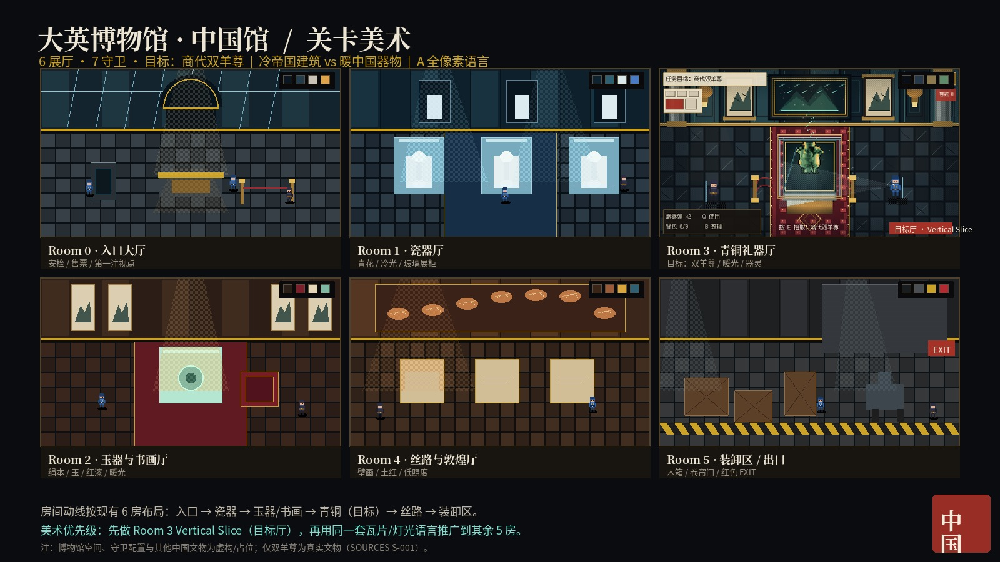
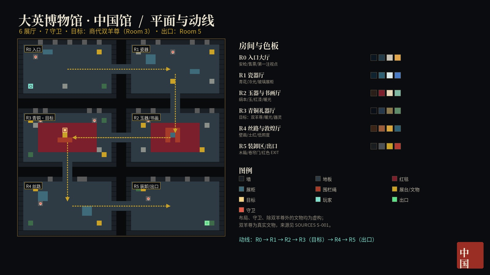
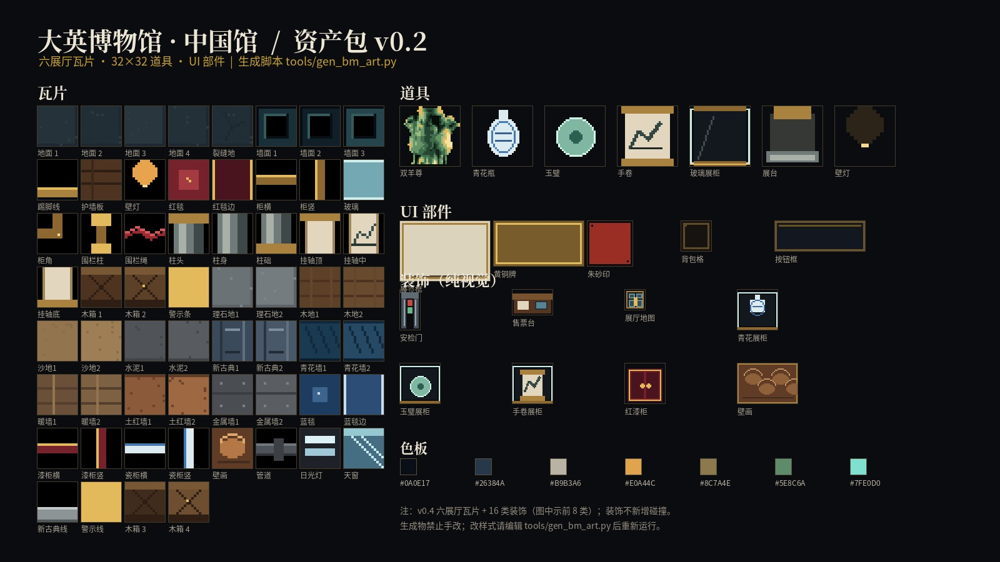
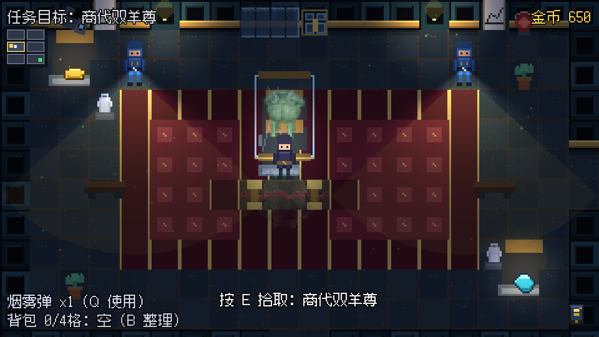
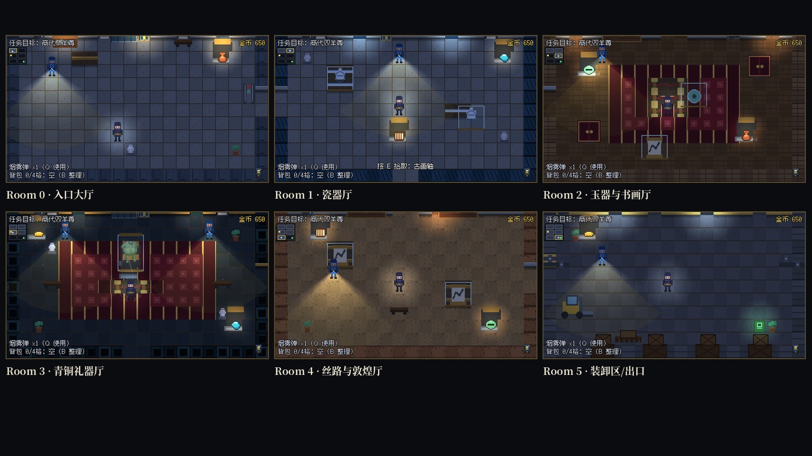
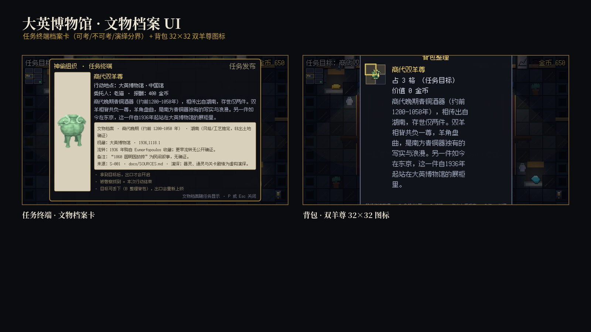

# 大英博物馆 · 中国馆 关卡美术

> 状态：美术方向 v1 ｜ 2026-10-19 ｜ 未接入游戏
> 上位规范：`docs/ART_DIRECTION.md`（A 全像素玩法 + 两层画面规则）
> 史料依据：`docs/SOURCES.md` S-001（商代双羊尊）
> 概念板：`docs/art_direction/BM_level_board.jpg`

---

## 1. 视觉命题

**冷帝国建筑 vs 暖中国器物。**

- 建筑：冷灰蓝大理石、科林斯柱、玻璃天窗、黄铜展签、监控与卷帘门——帝国的、石头的、秩序化的。
- 文物：青铜铜绿、玉的青白、丝绒红、金箔、书画的米黄——手作的、有温度的、被囚禁的。
- 玩家：低饱和深靛蓝，靠 1px 冷色轮廓光从背景里切出来；他/她是这个冷暖系统里的“第三种颜色”。

关卡动线从**公共展厅**逐步进入**后场装卸区**：灯光越来越冷、空间越来越工业、出口越来越近。目标厅（Room 3）是全关唯一允许“暖到发亮”的房间。

---

## 2. 六个展厅

> 房间矩形以 `src/levels/british_museum.json` 为准；房间编号沿用现有数据（Room 3 为目标厅）。  
> 博物馆空间、守卫配置、除双羊尊外的文物均为**虚构/占位**，不是对大英博物馆的真实复原。

| 房间 | 地图矩形 | 主题 | 色板 | 光 | Hero Object | 玩法作用 |
| --- | --- | --- | --- | --- | --- | --- |
| **Room 0 入口大厅** | `[0,0,20,12]` | 安检 / 售票 / 第一注视点 | `#0B1620` `#243B4A` `#C9C2B6` `#E0A44C` | 冷天窗 7000K + 暖服务台 3000K | 安检门 / 博物馆平面图 | 教学、第一巡逻、建立“这是博物馆” |
| **Room 1 瓷器厅** | `[22,0,20,12]` | 青花 / 玻璃展柜 / 冷光 | `#0F2230` `#2E5F73` `#DCE9EA` `#4A7AC4` | 展柜冷白 6000K，低环境光 | 青花大瓶 | 第二个巡逻、展示“玻璃+冷光”材质 |
| **Room 2 玉器与书画厅** | `[22,14,20,12]` | 绢本 / 玉 / 红漆 / 暖光 | `#2A1E18` `#7A1F2B` `#E6D6B8` `#7FB7A3` | 2700K 暖射灯 + 红漆反射 | 玉璧 / 手卷 | 第三个巡逻、为青铜厅做暖色过渡 |
| **Room 3 青铜礼器厅（目标）** | `[0,14,20,12]` | 双羊尊 / 铜绿 / 金 / 器灵 | `#0A0E17` `#26384A` `#8C7A4E` `#5E8C6A` `#E0A44C` | 2700K 主射灯 + 冷环境 + 文物自发光 | **商代双羊尊** | 目标、器灵事件、全关视觉高潮 |
| **Room 4 丝路与敦煌厅** | `[0,28,20,12]` | 壁画 / 土红 / 低照度 | `#3A2418` `#9A5B3A` `#D8A63C` `#2F5F73` | 2400K 低暖光、尘埃 | 敦煌壁画 / 经卷 | 第四巡逻、情绪下沉、接近后场 |
| **Room 5 装卸区 / 出口** | `[22,28,20,12]` | 木箱 / 卷帘门 / 红色 EXIT | `#1A1D20` `#4A4F55` `#C9A227` `#B23A32` | 冷荧光 5000K + 红色出口灯 | 木箱 / 叉车 / 出口 | 最终巡逻、撤离、出口上锁判定 |

**动线**：Room 0 → Room 1 → Room 2 → Room 3（目标）→ Room 4 → Room 5（出口）。  
实际连通以 JSON 为准；美术上保证每条走廊都有明确的“从冷到暖再变冷”的色温变化。

---

## 3. Room 3 目标厅：Vertical Slice 规格

这是第一个要真正做进 Godot 的房间，其他房间复用它的瓦片/灯光/UI 语言。

### 3.1 构图

- 20×12 格，摄像机锁定单屏；中央红毯从底部延伸到展柜。
- 展柜位于房间中心偏上，双羊尊 32×32 像素 sprite（或 30×34 展示尺寸），玻璃罩边缘高光。
- 两侧各一根壁柱/展柜，形成对称；左右上方各一盏壁灯。
- 背景墙：中国山水壁画 + 两幅挂轴；黄铜展签；不堆砌红灯笼/龙凤。
- 地面：冷灰蓝大理石，红毯压住中心；展柜下方有暖色光池和倒影。
- 角色：盗贼从左侧阴影接近；警察从右侧巡逻，手电光锥扫过红毯。

### 3.2 灯光

| 层 | 色温 | 实现 |
| --- | --- | --- |
| 主光 | 2700K 暖 | 展柜上方 `PointLight2D` + 噪点光锥，强度 1.2，轻微呼吸 |
| 环境 | 7000K 冷 | `CanvasModulate` 冷蓝 + 低强度补光 |
| 展柜 | 3000K | 玻璃罩内小范围点光，照亮文物顶部 |
| 文物 | 金绿自发光 | 文物 sprite 外加 1.5 格加色光晕，颜色随材质 |
| 幽灵 | 青绿 | 拾取后出现；房间降饱和 30%，幽灵加色混合 |
| 手电 | 5000K 冷白 | 警察 `Flashlight` 光锥，随朝向旋转 |

### 3.3 材质

- 青铜：铜绿 `#5E8C6A`、高光 `#C9B36A`、阴影 `#2E3B2E`；兽面纹用 1–2px 暗线概括，不做照片纹理。
- 玻璃：边框黄铜 + 1px 冷白高光 + 15% 透光；斜向反光只保留 1 条。
- 大理石：冷灰底 + 2–3 条细 veins；接触阴影要压住展柜和角色。
- 红毯：深红 `#6A1A26` / `#8E2432`，金线包边，中心菱形纹样。
- 木箱/后场：深木色 + 黄铜包角 + 黄色警示条；和展厅的精致感形成反差。

### 3.4 UI

- 任务目标：左上角米白展签，细金线，朱砂小印。
- 金币：右上角黄铜铭牌。
- 背包：左下角皮质挎包。
- 警戒：右上角朱砂印章；等级用盖章次数表示。
- 小地图：建筑平面图，当前房间暖光填充，目标厅用金色标记。
- 交互提示：“按 E 拾取：商代双羊尊”居中偏下，带 1px 深色描边。

---

## 4. 资产清单（Room 3 优先）

### 4.1 瓦片（16×16）

| 类别 | 数量 | 说明 |
| --- | --- | --- |
| 大理石地面 | 6 | 3 种明度 × 2 种纹理；带磨损边 |
| 墙面/壁柱 | 8 | 冷灰蓝面板、黄铜线、柱头/柱础 |
| 红毯 | 4 | 中心、边缘、转角、菱形纹样 |
| 展柜/展台 | 6 | 玻璃框、黄铜边、底座、反光条 |
| 绳索/围栏 | 4 | 黄铜柱 + 红丝绒绳 |
| 挂轴/壁画 | 4 | 山水、书法、空白展签 |
| 后场 | 8 | 木箱、托盘、卷帘门、警示条、管道（Room 5） |

### 4.2 道具

- 双羊尊：32×32 游戏 sprite（`artifact_ram_zun.png` 或转台条 `relic_ram_zun_strip.png`），外加 32×32 背包图标。
- 青花大瓶、玉璧、手卷、青铜爵/鼎（占位虚构，不登记真实文物名）。
- 展签、黄铜铭牌、隔离绳、长椅、监控摄像头。
- 木箱、泡沫、叉车、托盘、出口指示灯。

### 4.3 角色

- 盗贼 16×24：4 方向 ×（待机 2 + 走路 4 + 蹲下 2 + 交互 2）。
- 警察 16×24：巡逻、调查、追击、逮捕；夜班主管可换色/加肩章。
- 对话头像 32×32：老猫、鉴定师、归还线人（后续）。

### 4.4 特效

- 光锥、尘埃、玻璃反光、地面倒影、烟雾、幽灵墨点。
- 屏幕后处理：轻 bloom、暗角、细颗粒、冷暖分离；不要滤镜感。

### 4.5 资产包 v0.1（已生成）

生成器：`tools/gen_bm_art.py`（重新生成：`python3 tools/gen_bm_art.py`）。

| 文件 | 内容 |
| --- | --- |
| `assets/sprites/bm/bm_tiles.png` | 16×16 瓦片图集（8×4）：地面、墙面、踢脚线、护墙板、壁灯、红毯、展柜、围栏、挂轴、木箱、警示条 |
| `assets/sprites/bm/bm_props.png` | 32×32 道具图集：双羊尊、青花瓶、玉璧、手卷、玻璃展柜、展台、壁灯 |
| `assets/sprites/bm/bm_ui.png` | UI 部件：展签框、黄铜牌、朱砂印、背包格、按钮框 |
| `assets/sprites/bm/bm_zun_32.png` | 双羊尊 32×32 目标 sprite（由实拍图降采样/限色/描边生成） |
| `docs/art_direction/BM_asset_sheet.jpg` | 资产预览板 |

**边界**：v0.1 覆盖 Room 3 主体与通用博物馆瓦片，已接入 `museum.gd`；其余 5 房沿用同一生成器与主题接口扩展。生成物禁止手改；改样式请编辑 `tools/gen_bm_art.py` 后重新运行。

### 4.6 Room 3 实机接入（v0.13.0）

- `museum.gd` 新增 `_room_of_tile` 房间查找与 `_draw_bm_tile()` 主题绘制：`level_id == "british_museum"` 且房间索引为 3 时，地面/墙面/踢脚线/红毯/展柜/围栏/挂轴/壁灯使用 `bm_tiles.png`。
- 目标双羊尊：`BMDisplayCase`（`bm_case.png` 玻璃展柜）+ 暖色 `PointLight2D`；目标厅的文物自身 glow 调低，避免过曝。
- 房间 3 的 `p`/`T`/`a` 使用 `bm_props.png` 的展台；雕像/盆栽/出口沿用原资产，保证玩法不变量。
- 测试：内容一致性 248 项（新增 bm 资产尺寸校验）、冒烟 97 项（新增 BM 展柜存在性）。`tools/verify.sh` 7 项全绿。

### 4.7 六展厅主题接入（v0.2）

- `museum.gd` 的 `BM_THEMES` 现在覆盖 Room 0–5；`_draw_bm_tile()` 按房间查表，不再写死 Room 3。
- 房间气质：
  - **Room 0 入口**：冷理石地面 + 新古典灰蓝墙 + 大理石踢脚线（暖壁灯）
  - **Room 1 瓷器厅**：冷理石 + 青花蓝墙 + 蓝白展柜（冷白灯）
  - **Room 2 玉器/书画厅**：木地板 + 暖墙 + 红漆展柜 + 红毯
  - **Room 3 青铜礼器厅**：深蓝石墙 + 铜绿展柜 + 红毯 + 目标双羊尊
  - **Room 4 丝路/敦煌厅**：沙地 + 土红墙 + 壁画 + 低暖光
  - **Room 5 装卸区**：水泥地 + 金属墙 + 警示线 + 日光灯 + 红色出口
- 全局夜色调在大英博物馆关卡改为较亮的冷蓝（`NIGHT_TINT_BM`），保证新瓦片可读；各房间壁灯颜色由 `_bm_lamp_config()` 分流。
- 仍复用原有碰撞、房间相机、噪音/幽灵分流；只改绘制与灯光，不碰玩法不变量。

### 4.8 装饰层（v0.3）

- 新增 13 个纯视觉装饰 Sprite：`assets/sprites/bm/decor/*.png`（安检门、售票台、展厅地图、青花/玉璧/手卷展柜、红漆柜、壁画、木箱堆、托盘、叉车、管道、长椅）。
- `museum.gd` 新增 `BM_DECOR`（房间 → cell + offset）与 `_build_bm_decor()`；装饰作为 Sprite2D 直接挂在关卡下，参与 y 排序，但**不新增碰撞**。
- 各房间重点：
  - Room 0：安检门、售票台、展厅地图、长椅
  - Room 1：青花展柜 ×2、展厅地图
  - Room 2：玉璧展柜、红漆柜 ×2、壁画、手卷展柜
  - Room 3：长椅 ×2、展厅地图
  - Room 4：壁画 ×2、手卷展柜 ×2、长椅
  - Room 5：木箱堆 ×4、托盘、叉车、管道 ×2
- 测试：内容一致性 287 项（新增 13 类装饰尺寸校验）、冒烟 98 项（新增 `bm_decor_count > 0`）。`tools/verify.sh` 7 项全绿。
- 下一步（v0.4）：可做装饰的动画/交互反馈（喷泉、监控摄像头、警报灯），或把 `bm_zun_32.png` 接到档案/背包 UI。

### 4.9 装饰动效 + 文物档案 + Room 3 光影收口（v0.4）

**装饰动效**（纯视觉，不参与判定）：
- 监控摄像头左右缓慢转头（Room 0/1/2/3/4/5 顶墙）
- 警报灯呼吸闪烁（Room 3/5）
- 入口/青铜厅天窗微亮呼吸
- `museum.gd` 的 `_bm_cameras / _bm_beacons / _bm_skylights / _bm_glints` + `_animate_bm_decor()`，在 `_process` 里按正弦函数驱动。

**Room 3 光影收口**：
- `BMDust`：CPUParticles2D 尘埃，围绕展柜缓慢上浮
- `BMZunReflection`：`bm_zun_32.png` 垂直翻转 + 16% 透明度的地面倒影
- `BMGlassGlint`：Line2D 玻璃高光，呼吸式明暗
- 加上原有的玻璃展柜、暖光池与压低的文物 glow，目标厅现在是全关光影重点。

**文物档案 UI**：
- `Game.ARCHIVE`（`src/autoload/game_state.gd`）：真实文物的「年代 / 原在地 / 现藏 / 流转 / 备注 / 来源 / 演绎」字段，与 `docs/SOURCES.md` S-001 对齐。
- 任务终端（手机）新增**文物档案卡**：明确区分「可考 / 不可考 / 民间传说 / 虚构演绎」，圆明园说以「民间叙事，无确证」呈现。
- 背包 `BagGrid` 为 `ram_zun` 接入 `bm_zun_32.png` 图标，替代原来的色块。

**测试**：内容一致性 304（档案字段 + 动效装饰尺寸）、冒烟 103（尘埃/倒影/玻璃高光/档案卡）、逻辑 2488；`tools/verify.sh` 7 项全绿。

---

## 5. Godot 落地建议

1. **瓦片**：用 `TileMapLayer` + terrain 自动过渡；保留现有 16×16 / 20×12 房间尺寸，不改碰撞与相机。
2. **房间主题**：在 `museum.gd` 的建图流程里按 `level_id + room_index` 选主题 palette / 瓦片 set；不要硬编码到每个场景。
3. **灯光**：`CanvasModulate` 做房间底色；`PointLight2D` 做展柜/壁灯；警察手电沿用现有 `Flashlight`；展柜玻璃用独立 `Sprite2D` + 高光贴图。
4. **法线/高光**：优先给青铜、玻璃、大理石做手绘高光层；如果 Compatibility 渲染器下 2D normal map 成本可控，再加法线，不要一上来全量。
5. **后处理**：用一个全屏 `ColorRect` + shader 做暗角/颗粒/冷暖分离；参数按房间可调（后场更冷、更脏）。
6. **性能**：单房间同时不超过 3 个动态光 + 1 个手电；粒子上限 200；目标 60fps，集显可跑。
7. **生成物纪律**：正式美术不要手改 `assets/sprites/*.png`。建议新增 `assets/art_src/british_museum/` 存源文件，加 `tools/build_bm_art.py` 导出到 `assets/sprites/bm/`，并在 `docs/DECISIONS.md` 记录“正式美术源文件 vs 生成物”的边界。

> 现有 `museum.gd` 已经按 JSON 建图、按房间切相机、按房间分流噪音/幽灵；美术替换应尽量复用这些不变量，不重写玩法。

---

## 6. 历史与虚构边界

- **真实**：商代双羊尊（大英博物馆 1936,1118.1）；年代、尺寸、产地推定、入藏经过见 `docs/SOURCES.md` S-001。
- **不可考**：具体出土地点、如何离开中国、Eumorfopoulos 如何获得；没有公开档案。
- **民间传说**：1860 年圆明园劫掠说——无确证，游戏内只能以“传闻/待考”出现。
- **虚构**：博物馆关卡布局、守卫配置、盗窃行动、其他中国文物、器灵与通灵能力。
- **D 画面**：湖南（推定）·商代晚期祭祀原在地，意象复原，非考古复原；时间线明确标注「可考 / 不可考 / 民间传说」。

---

## 7. 生产顺序

1. **Room 3 Vertical Slice**：瓦片 + 展柜 + 双羊尊 + 盗贼/警察 + 灯光 + UI，跑 3 张截图。
2. **Room 0 / Room 5**：入口与后场，建立“公共 → 后场”的冷暖反差。
3. **Room 1 / Room 2 / Room 4**：瓷器、玉器/书画、丝路，复用 Room 3 的材质与灯光模板。
4. **全关统一**：色温曲线、尘埃密度、警戒 UI、性能回归。

---

## 8. 验收清单

- [ ] 640×360 下 3 秒内能指出玩家、警察、目标文物、出口。
- [ ] 灰度下玩家/警察/文物仍能靠明度分开。
- [ ] 红绿色弱下，警戒/目标/普通物仍能区分。
- [ ] 双羊尊在像素画面里是像素 sprite，不出现实拍抠图。
- [ ] 单房间 ≤ 3 动态光 + 1 手电；60fps。
- [ ] 所有真实文物/事件均有 `SOURCES.md` 登记；传说内容标注“待考/传闻”。
