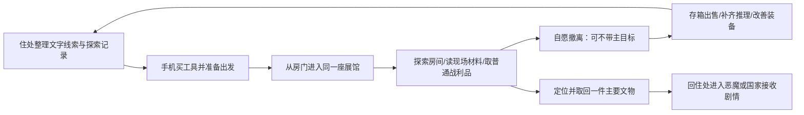

# 多次潜入、探索地图与道具准备

日期：2026-11-19。状态：按用户最新方向采纳的后续设计；本批只同步方案，不表示下述功能已经实现。当前确认入口见[CONFIRMED_DESIGN](CONFIRMED_DESIGN.md)，实施任务见[ROADMAP](ROADMAP.md)。

用户方向：不在局外获得全地图；较大的展馆通过玩家探索揭开迷雾；可以分多次探索，最终带出三件主要文物之一；途中普通战利品能带回出售，在手机买工具，帮助下一次探索。

本方案采用下述默认规则。房间数、期望出勤次数、货物价格和奖励密度是初期设计目标，仍须灰盒试玩调参，不能当作用户逐项裁定或已验证指标。

## 1. 一个完整循环

出门时可选“继续侦察”或追踪一个已知目标，两者进入同一张稳定地图。不把任务准备切成彼此独立的小副本。侦察途中若已满足取物条件，也可直接带出选定主目标，不强制先回家点一次“最终行动”。身份与柜号可以在现场由玩家核对；不把“必须回电脑连完全部卡”设为实物拾取的额外门槛。门锁、负重与真实取物条件仍然生效。

未预先选目标的侦察，也可在现场核对后把该件设为本次目标；这只改变追踪与取物状态，不重置守卫、不换展位或重新生成物品。

三件主要文物仍只带走其中一件完成本段主任务；不要求清空三间展厅，也不必完成另外两条调查链。一次行动不能带走第二件主要文物。普通战利品另行处理。

## 2. 地图如何变大而不只增加走路

正式布局初始目标为10–12个有用途的房间/区域：入口与外围、资料/服务区、连接走廊、三个主要展厅、库房和后勤出口。复用已有地砖、家具与门，不新增六件相似文物模型。

先做4–5个区域的玩法样板：入口、普通展厅、资料点、一个主展厅、服务通路/出口；验证每次探索有收获，再扩展三条区域支路。最终数字依试玩调整，房间不会因为格子填满就算完成。

布局要求：

- 主展厅分布在不同支路，通过服务通道和可开捷径形成回路，避免三条长死胡同。
- 从入口向外至少有两个可探索方向；探索点之间放置能作判断的门牌、便条或环境线索。
- 每区有可辨认的地标，例如布展架、货梯口、档案桌；避免十几间同色方屋只靠记坐标。
- 先走的路线能引向下一次要准备的工具、缺少的资料或新的入口；空房不能反复消耗行走时间。
- 大馆布局在同一章节内稳定，不每次重洗房间、交换展位或随机堵住刚学会的路线。
- 守卫继续承担潜行压力，沿用确定性规则；本批不采用此前撤回的“九件相似品、三个无巡逻限时鉴别厅”方案，也不恢复全馆闭馆倒计时。

## 3. 首版迷雾按房间揭开

初版采用房间级迷雾，不先做逐像素视野或每块地砖的射线遮挡。当前相机本来按房间展示，房间级方案更便于落实与核验。

| 信息 | 初始状态 | 何时出现 |
| --- | --- | --- |
| 入口/当前所在区域 | 已知 | 初次进入 |
| 未进入房间的轮廓与面积 | 不显示 | 玩家实际进入后才绘制 |
| 当前房间可见的门 | 可标为“未探门” | 看到门或读到门牌 |
| 门后的连接目标 | 不凭门的存在揭晓 | 穿过门或取得能证明连接的现场材料 |
| 主展厅名称、展柜和出口图标 | 不从关卡数据自动显示 | 实际见到或取得可定位的现场信息 |
| 守卫、监控、普通物品的位置 | 不预先显示在未知区域 | 实地观察；不跨墙透视 |
| 已走过区域 | 保留简图 | 跨次潜入持续保留 |
| 有文字描述但未定位的区域 | 放入“待找地点”笔记 | 拿到材料后，不直接生成精确坐标 |

进入房间可揭开该房间本来就能看到的布局，但不画相邻未知房间，不标出所有房间的暗框。地图不能通过整体边框、图标、连线、缩放范围或悬停信息泄露完整布局。

旧版minimap只是把未访问房间涂暗，同时仍画出全部房间、目标与出口；这不满足新设计。visited_rooms现有运行内记录也不能当作跨次探索存档已完成。

## 4. 布展单与推理板保留探索空间

局外主要取得文字描述、尺寸、器形与历史记录，不由恶魔直接给三张可照着找的完整目标照片。具体对象的游戏内图像/观察笔记在实际看到它后加入板面，复用已有三件目标素材，不新增相似品。

三层材料分工：

1. 公开资料回答“是什么、有哪些特点、哪些经过能查到”。不含游戏当晚的实际坐标。
2. 布展/维护材料提供区域名、柜号、搬运要求或局部连接，例如“东厅G-04、与南侧服务间相连”。没有全馆平面图，不自动揭开东厅。
3. 现场门牌、通路与实物观察，把这些词与玩家走过的地图对应起来。只有这一步才能落下准确的已知地点标记。

例如拿到“G-04在东厅”后，任务写“寻找东厅与G-04”，地图上不凭空亮起目的地。玩家找到门牌后记录东厅，再把布展单与现场柜号连起来，确认目标。

“西屋”仍作历史出土地的辨析：玩家不能据此把游戏展馆西翼当成目标位置。这个判断的作用是告诉玩家缺什么材料，再促使他去找本次展位信息。

推理板跨次保留材料、待找地点和玩家完成的关系判断。先查清一件就能推进对应行动，不强制查完三条。缺关键信息时可给联络人回信追问；错误选项给出针对材料缺口的反馈，不自动替玩家接好整条链。

## 5. 多次探索的节奏

预期可形成2–4次有实际进展的潜入，但不硬性规定必须跑满次数，也不为了卡次数临时封死正确路线。熟练玩家可以更少次数完成。

示例节奏，非固定脚本：

| 本次准备做什么 | 可能带回什么 | 下次为何还值得进入 |
| --- | --- | --- |
| 先探外围 | 入口附近普通战利品、一段地图、区域指示 | 卖出后改善脱身能力；明确下一份资料的方向 |
| 找到后勤与资料点 | 柜号/布展单、钥匙线索、捷径入口 | 推理板能把“东厅”与现场标识接起来 |
| 深入一条主展厅支路 | 目标特征、可行通路、对应接收联络 | 带合适工具走更稳妥的取物路线，或当次直接完成 |
| 条件成熟时取物 | 三件主要文物之一 | 回住处作剧情交付选择 |

每次不必同时取得钱、线索和捷径，但应有其中一个值得保留的收获。试玩中如果出现连续两次回来都不知道学到了什么，优先调整线索位置与路线，不先继续扩大地图。

## 6. 撤离、回放与放弃分清楚

| 行为 | 实物结果 | 调查结果 |
| --- | --- | --- |
| 正常侦察撤离，没拿主目标 | 带出的普通物品入安全屋库存，等待出售；不记主任务完成 | 已发现地图、已读材料、完成的推理保留 |
| 带着选定主目标撤离 | 消费一次行动结算，记录目标已带回，进入交付剧情；普通物品照常入库 | 已有调查保留 |
| 被发现后使用现有免费回放 | 世界、背包、道具消耗等恢复完整预演起始快照，不凭空获得物品或退款 | 玩家看过的知识可保留在独立调查记录，不借此保留被回滚的物理收益 |
| 主动放弃本次行动返回住处 | 本次未带出的普通物品和主目标回到本次开始的合法位置；不发销售收入；已实际使用且未回滚的消耗品不退 | 已探索地图、已读材料保留 |

普通侦察允许空手撤离。不能继续把“背包里没有主目标”作为大馆唯一的出口上锁条件。面具教学仍可以要求完成教学目标后撤离。

“mission_complete”仍表示实际携带指定任务目标，不为允许侦察退出而把它强行设成true。结算必须区分“侦察撤离、主目标带回、放弃”，不能把侦察结算误送到恶魔交付剧情。

免费回放继续保留原路线供修改，无扣命、无额外等待。回放与一次潜入的主动结束不同，不能拿旧失败结算直接代替。

## 7. 哪些进度跨次保留

- 已走过的地图、已读线索、已完成的关系判断：属于玩家知识，跨次保留，包括主动放弃后的下一次。
- 已知门牌、口令和“门后大概是什么”的材料：属于调查信息；口令能否实际开门仍由当前世界状态校验。
- 本次实际打开的永久捷径、带出的实体钥匙：正常撤离后提交到长期进度。免费回放仍回滚本次尚未提交的物理变化，不凭知识记录给玩家复制钥匙或自动开门。
- 已购买的永久装备、住处库存和交易余额：属于局外状态，潜入回放不能把此前购物撤销。
- 玩家与守卫位置、巡逻/警觉、监控相位、烟雾寿命：每次新潜入按明确起始快照初始化，不把上一趟追击保存在入口继续抓人；同次规划/执行仍严格共享快照。
- 主目标取回或剧情交出后不能在新潜入中再生成一件；检查点重玩属于独立回溯流程，不与现存交易/库存账混用。

## 8. 普通战利品与钱

普通战利品沿用“带回→放箱→手机预约→取出→门外交货→一次性收钱”的已确认流程；不撤离自动卖钱，不把主要三文物加入普通交易。

必须给关卡里的每件普通物品稳定实例ID，物品类型可以相同，实例不能重复。正常带出后原位置不再生成同一件；已售实例不复活。放弃/回放只回滚本次尚未带出的实例。

本章不无限重刷已带出的高价普通物品。预算应支持初次玩家买到有帮助的工具；不能因为有限战利品加上失败消耗导致主线破产锁死。

保障方式：每个主展厅至少有一条不依赖强制购物的调查/钥匙路线；基础调查与地图记录免费；高价值物品不按固定出勤次数解锁。没有钱仍能探索，工具让过程更方便。

目标是让玩家比较“这趟继续深入，还是先把收获带回”，不强迫为一件必需工具反复刷同一个房间。

## 9. 手机购买与配装

手机增加“采购”入口，库存与文物箱分开显示。首版仅安全屋可下单，按一次确认扣一次钱，订单加入备货库存；下一次出发前选择携带，不在展厅里即时买烟雾救命。

不先做快递时钟、每日刷新或长时间送货。商品卡写清消耗品/永久装备、实际效果、数量和价格；重复确认、重开手机、存读档不能重复扣款或发货。取消未完成的事务恢复原状态，已确认购买不能借返回键重复退款。

首批商品建议：

| 道具 | 作用 | 首批范围 |
| --- | --- | --- |
| 烟雾弹 | 保留既有近距离脱身功能，帮助深入与撤离 | 优先复用现有效果 |
| 跑鞋 | 保留既有疾跑速度改善，缩短危险区暴露与往返 | 优先复用；名称不要暗示代码里没有的完全无声效果 |
| 撬锁工具 | 为已发现的维护门提供一条更便利的进入方式 | 下一批接门交互；同时保留场内钥匙/调查路线，避免硬性付费门槛 |

后续可加诱饵或其他侦察工具，但不同时铺满商品类别。道具不能买出完整地图、隔墙显示主目标或替玩家完成推理。暂不扩战斗、技能树或复杂背包成长系统。

## 10. 规划和迷雾的边界

- 规划时世界完整冻结，任何执行、接管、取消、重试路径一起恢复；保留v0.23.3修复，不恢复子弹时间。
- 只能在已探明的可走区域编辑路线；不能点击未知格子用寻路试探房间轮廓。
- 预演轨迹、守卫残影、摄像头信息、失败预警不得越过未侦察区域泄露秘密；布展单不自动提供守卫完整巡逻表。
- 信息不足的门外区域标明未知风险，不把未观察到写成“确定安全”。同一完整快照下的模拟仍须确定性、一致；信息展示限制不能成为引擎结果随机变化的理由。
- 灰盒的逐tick一致性验收继续保留；在迷雾场景增补“内部模拟可运行、展示不泄露未知情报”的独立测试。

## 11. 实施次序与现状

当前代码已有房间、运行内visited_rooms、普通战利品、出售规则、烟雾/鞋子等基础，但还没有本方案完整流程：现有小地图泄露整体结构，探索记录未持久化，未拿主目标不能按新规则结算，手机采购与独立安全屋仍待实现。

实施按一条最短闭环逐批验收：

1. R-11a：4–5区域样板、房间迷雾、现场地标与不泄密的布展信息。
2. R-13a：地图/线索跨次保留、侦察撤离与免费回放边界，证明“去一趟再回来”不会丢失或复制进度。
3. R-12a：通过实体安全屋与手机接入现有烟雾/跑鞋采购；接上普通文物箱和交易，验证带出→卖钱→采购→再次出门。
4. R-11b/R-12b：按样板结果扩到10–12区域、三主展厅与一类工具捷径。
5. R-08：完整多次探索测试、经济与知识收益试玩；次数、时长和难度只按真实记录判定。

房间、地图仍从生成脚本产生，不手改生成JSON。新增状态必须按稳定level/room/door/item实例ID保存，保留旧存档字段语义，默认值/脏档/未来档与检查点分开测试。

## 12. 验收清单

- 初次打开地图没有未知房间框、主目标点或后勤出口点；布展单不会直接解开全图。
- 行走发现房间与门，退出再进入仍保留记录；只读材料与实地确认有不同状态。
- 不带主目标也能正常撤离并保留普通战利品；不能提前触发恶魔交付或伪造mission_complete。
- 普通物品带出、存箱、预约、交货后一次性移除与付款；重进馆不再出现已售实例。
- 手机采购确认一次扣款一次发货，局内不可采购；永久装备、库存与携带数量分清。
- 至少存在一条无需购买必需品的主线可行路线，无钱/空背包不锁死探索。
- 免费回放恢复物理快照并保留路线，知识记忆保留不复制物品；主动放弃不发带出奖励。
- 现场捷径、钥匙与知识分别保存，回放不擅自保留尚未提交的物理变化。
- 未完成另外两条文物线，仍可按已核实的一件完成本段主任务。
- 路线编辑与预演不穿透迷雾；新布局下预演/执行仍满足同快照确定性及冻结契约。
- 三个主要目标各自有能从局外描述与现场线索推到的路径；不靠六件新相似文物制造难度。
- 通过真实试玩记录每趟获得的地图、线索、钱与下一步意图，不能用“房间多了”代替探索乐趣验收。
