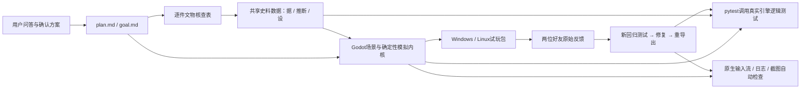

# 当前执行入口：继续开发完整游戏（2026-11-20）

OpenCode接到继续开发任务后，执行[后续开发计划与验收门槛](docs/OPENCODE_NEXT_PLAN.md)，按[ROADMAP](docs/ROADMAP.md)认领对应子项。先补真实关卡确定性/回退，再做探索样板、安全屋、交易采购、调查剧情、三主展厅与交付。每批实施并验证后推进，不能只更新文档。

**下方全部为课堂阶段历史记录，不再是当前执行指令。** 其中“今晚不做完整安全屋”等时间范围不能限制本轮后续开发；仍有效的用户裁定已纳入上述当前计划。不得依据旧课堂演示切片声称完整游戏完成。

---

> **2026-11-19后续开发优先级**：下面是课堂切片的历史计划，不能作为长期缩减玩法的依据。后续遵循[确认方案](docs/CONFIRMED_DESIGN.md)、[多次探索方案](docs/EXPLORATION_LOOP.md)与[剧情补丁V2](docs/narrative/EXPLORATION_PATCH_V2.md)，按[ROADMAP](docs/ROADMAP.md)认领R-11~R-13及其安全屋/设备依赖。不得恢复全图、三链全解才能出发或没主目标就锁侦察出口；本轮仅同步设计，相关功能尚未实现。

> **2026-11-18 Loop 1展示材料已补齐**：[目标声明](goal.md) · [真实需求摘录](docs/demo/loop1/QA.md) · [离线项目图与展示页](docs/demo/loop1/index.html) · [约50秒讲稿](docs/demo/loop1/README.md)。这是课堂证据整理，不将下面历史计划的待办自动改为完成；未伪造Plan-mode或/goal执行记录。

# OpenCode执行计划：桌面试玩与课堂演示

日期：2026-11-18；目标：2026-11-19上课前就绪。**用户最新决定：不做Cloudflare部署，改用Godot原生桌面包交付朋友试玩。** 本次仅修订计划，下面的开发、导出、安装和好友测试尚未执行。

## 0. 执行指令与范围

请执行本计划。优先让真实游戏切片、桌面包、自动测试和两位好友反馈回归可以在课前准备好，并在5分钟内现场演示。先读AGENTS、当前确认方案、项目技能和ROADMAP，再检查git status/diff并认领课堂专项。历史“仅文档”是之前批次范围，不是本次执行任务的永久禁令。

**取消Cloudflare Pages/R2、域名、HTTPS发布、WASM体积优化和公网好友试玩的前置任务；不要为这些事项反复请求账号或阻塞桌面准备。** 不为课堂另造网站，不把Playwright安装作为桌面交付的必要依赖。已有Web导出可保留，不删除，不默认继续维护它。

不要覆盖并行改动。规划读取时已有CHANGELOG、README、ROADMAP、src/sim/sim_preview.gd、tests/test_sim_preview.gd未提交修改，执行前重新核对归属。不重写引擎，不恢复倒计时，不今晚全面补完安全屋、交易、三线剧情和正式美术。

## 1. 课堂要求差异：如实呈现，不伪造通过

本计划按用户选择准备桌面方案，**未取得老师对替代方案的确认**。保留以下差异作为展示边界，而不是重新增加部署任务：

| 老师原文 | 本次桌面方案 | 能否按原文字面声称满足 |
| --- | --- | --- |
| Plan问答、plan.md、goal与项目图 | 保留真实问答、目标和已渲染的项目图 | 可按实际证据展示 |
| pytest/vitest＋Playwright | 优先pytest调用真实Godot逻辑/历史边界，Godot输入流测原生UI | pytest部分可展示；原生UI测试不能冒充Playwright |
| @playwright/mcp、浏览器自动检查、live HTTPS URL | 改为原生自动运行、错误日志、输入流与截图证据 | 这是项目适配替代；浏览器/MCP/URL原文项未完成 |
| 两位好友在public Cloudflare link反馈 | 两位好友下载同版桌面包，反馈后修复并补回归 | 可证明真实好友闭环；public link条件未完成 |

不要声称老师已豁免要求，不将本地文件路径/下载链接称为运行中的HTTPS游戏。若老师不接受替代，记录差距；后续只有用户改回Web路线时才重新安排部署。不要用网页里的静态介绍、伪MCP截图或空测试假装完成浏览器闭环。

## 2. 最小展示切片与当前状态

复用Godot项目与src/sim/sim_preview.gd，把实际可用的确定性灰盒接成可操作场景：点路线→预演→执行→真实发现tick/原因→恢复起始快照并保留路线修改。若尚未接入，先完成这条最短闭环，不把纯逻辑测试演示成已经完成的可玩预演。

当前内核和tests/test_sim_preview.gd已存在，但具体实现与断言必须重新核对；守卫距离判定等灰盒简化不能说成完整视锥/遮挡已经实现。预演和执行要调用同一实际内核，不复制一份假模拟给演示用。

在游戏现有史料/声明界面展示三件文物的“据／推断／设”、来源和未核实项；引用同一份正式内容数据，不另写只有测试读取的假材料。

完整安全屋、箱子交易和三条线仍是长期目标；本次没有实现的内容明确保留为待办。

## 3. 优先级与时间安排

| 阶段 | 建议预算 | 必须产出 |
| --- | --- | --- |
| A 环境与导出确认 | 前20–30分钟 | Godot/模板/pytest/游戏启动可用；确认两位好友操作系统，导出适配包并在干净目录启动 |
| B 可玩切片与版本V0 | 接着60–90分钟 | 最短交互流程可操作、说明清楚、史料边界可见；尽早把V0包交给用户邀请两位好友，不等所有测试写完 |
| C 自动化与证据 | 等待反馈时60–90分钟 | pytest真实逻辑/史料测试、Godot原生输入与截图检查、报告与演示入口 |
| D 反馈回归修复 | 收到反馈后45–90分钟 | 两份真实原话、复现、针对性修复和新回归；导出V1复测 |
| E 冻结与排练 | 至少预留课前60分钟 | 固定最终包/源码/数据版本、5分钟排练、笔记本环境预检 |

预算不足就砍美化和扩展，不砍真实可玩性、测试或真实反馈。不要临近上课再装依赖、下载模板或临时开始写测试。

## 4. 桌面包交付：朋友不需要安装Godot

- Windows朋友提供Windows导出包，解压运行exe；Linux朋友提供Linux导出包。Mac需实际对应导出与启动验证，不把Linux包发给Mac用户当作能运行。
- **朋友只玩导出的程序，不用安装Godot或拿项目源码。** 开发/测试机器才需要Godot。确认导出是独立可运行版本，不是编辑器工程zip。
- 如果使用外置.pck，必须与exe一起打包；内嵌资源则核对确实是可独立运行的exe。解压到不含项目源码的新目录运行一次，检查资源路径、中文字体、输入和存档。
- 使用build/class-demo/等独立目录，避免tools/export.sh删除或覆盖他人的已有Web/Windows/Linux产物。只导出所需平台，不必同时打包全部平台。
- 包含中文试玩说明：解压/启动、操作、3–5分钟任务、已知限制、反馈方式、版本号。准备清晰文件名与SHA256。
- 用用户选择的文件传输方式交付，下载/分享地址只是包的分发入口，不宣称它是浏览器运行URL。不要擅自发消息给好友。
- 记录V0/V1包版本、构建时间、平台、源码版本与未提交状态；若源码未提交，额外保存源码快照标识/哈希，不能只写Git SHA就当成全部构建来源。
- 不在包里包含私人反馈、令牌、原始模型或无关资料；核对实际发布素材及已知授权情况。不改系统安全设置来绕过启动问题。

## 5. Loop1：真实规划与项目图

保留OpenCode实际Plan模式问答/已有真实会话，记录时间与截图或导出，放docs/demo/ideation/。不要新写一段对话冒充之前发生过的讨论。

根目录plan.md为本计划；创建goal.md写一句桌面演示目标、范围与完成判据。如果OpenCode确有/goal可真实使用并保存输出；没有则展示goal.md，不伪造命令记录。

将以下agent生成Mermaid按实际模块修订，课前渲染为本地SVG/HTML，确保离线能打开，不依赖课堂临时装工具或CDN：



## 6. Loop2：pytest＋现有Godot测试

优先Python虚拟环境＋pytest，不同时新搭Vitest，不为原生游戏硬装Playwright当测试装饰。若已有稳定框架则复用；本机依赖与版本在课前安装、固定。

建议创建（目前只是计划）：requirements-demo.txt、tests/demo/test_logic.py、tests/demo/test_history.py、简短预检脚本与docs/demo/RUNBOOK.md。不要改写原有规则或降低门槛来获得绿灯。

### 程序逻辑

pytest用subprocess运行真实Godot测试，检查退出码、实际断言结果、引擎错误和超时；缺引擎或解析失败不能skip后报全绿。可输出结构化JSON供pytest断言，但不能在Python另复制一套游戏逻辑与自己比较。

现场短套件覆盖：同快照/同路线的预演与逐tick执行一致；失败准确归因、恢复快照与保留路线；非门口开锁不成功；噪音调查结束警觉复位。不能用重复调用同一预演函数取代实际执行路径的测试。

### 历史边界

依据CONTENT_REVIEW/SOURCES对实际使用数据建立claim_id、relic_id、classification、text、source_id/url、evidence_locator、review_status、verified_at、inference_basis、fiction_note等字段。网页/书页的史料支持定位与UI节点定位是不同概念。

- 据：来源直接支持且已审阅，显示出处/归因；存在URL不代表史实核实通过。
- 推断：显示推断标签和推理依据，不从1936入藏推导1860被掠。
- 设：恶魔、同馆借展、安保、NPC接洽和交付等创作明确标虚构。
- 未核实：正式追索缺证据时保持未核实，不能扩大成“没有追索”或“已正式索回”；圣甲虫不能写成大英实藏，注壶登记不等于伦敦现藏。

cutoff默认解释为史料数据的冻结时点，不是已删除的游戏倒计时。若课件另有定义，按其明示定义调整。执行者记录真实冻结时刻、时区和数据版本，不伪造访问时间。截止后的材料不能混入冻结集；日期未知要标未知，不能编造日期。

测试据缺来源/定位/审阅状态、推断缺依据、设缺虚构标签；截止前/等于/之后、时区与未知日期；未核实材料不可被筛选成确证。自动结构检查不等于史学真实性已自动审定。

## 7. 原生自动操作闭环（Loop3的桌面替代）

按用户当前路线，使用现有Godot真实输入流与截图机制完成“运行→操作→读错误→截图→修复→重跑”。这是原生自动化，不声称等同@playwright/mcp浏览器检查。

- 启动实际Main/灰盒场景，注入真实鼠标/键盘事件，覆盖规划、执行、接管、失败回退、史料界面。
- 对实际节点状态与可见结果断言，不只直接调用open/close，也不只测进程能启动。
- 使用有图形渲染的离屏窗口或适合本机的虚拟显示生成截图；纯headless不一定提供可用画面，先实际验证，不用空白图当截图证据。
- 记录引擎日志、退出码、场景/版本、输入步骤、截图路径与失败原因。错误/警告按仓库已有有理由的规则检查，不广泛屏蔽。
- 桌面导出包至少在无源码的解压目录做启动和关键操作检查；如果UI自动化只覆盖编辑器运行场景，说明覆盖边界，不把它说成已自动驱动独立exe的完整流程。
- 不向独立exe传入只支持源码工程的res://测试场景后宣称测试成功。不要用静态状态标签、伪控制台或预录视频替代实际自动运行。

若现有本地Web版本和浏览器工具已经稳定可用，可自选保留本地Playwright/MCP补充演示，但不是本计划前置、不得拖延桌面包。它仍不满足public Cloudflare URL条件；不能用Playwright直接驱动原生Godot窗口。

## 8. Loop4：两位好友下载试玩 → 回归

V0包能运行即由用户邀请两位真实好友，先确认各自平台。每人3–5分钟完成“找入口、点路线预演执行、找一条史料标签与来源”的小任务，不提前教他们每个按钮位置。

原始记录放docs/demo/feedback/：匿名A/B、实际时间、系统/设备、包名/版本/哈希、原话或原始截图、复现步骤、预期与实际。可以准确转录原话，不能agent代写反馈；私人截图公开需本人许可。此前用户自己的试玩意见不能改名成朋友A/B。

收到后优先各选一个真实、可复现的问题：

1. 建立F-A/F-B→原始反馈→复现→修复文件→新测试的映射。
2. 对bug先写实际在未修复版失败的测试并保留red结果；修复后green。用隔离worktree复现旧版本，不能回滚共享工作区或人为造bug。
3. 若是新功能/易用性建议而非bug，记录验收标准并验证改进，不伪造旧版红灯。
4. 重导出V1到干净目录复测新回归与关键操作，可能时让好友再确认。
5. 保存前后截图、真实测试输出和包版本，写feedback-index.md供现场迅速展示。

好友未回复就如实记待反馈，继续其他工作并提醒用户，不生成虚构原话/通过记录。

## 9. 现场入口与交付

以下是建议路径和命令，执行者需创建并验证，不能原样宣称它们现在可用：

```bash
source .venv/bin/activate
python -m pytest tests/demo/test_logic.py tests/demo/test_history.py -q
~/.local/bin/godot --headless res://tests/test_input_flow.tscn
# 截图使用预先验证的图形/离屏命令，写进RUNBOOK；不临时摸索
```

现场短套件目标30–45秒内，实测后挑选展示；完整tools/verify.sh在课前运行并记录，不全塞进5分钟。若运行测试依赖源码与Godot，明确这是开发者测试环境，不是朋友运行包的要求。

必须交付：

- goal.md、真实Plan问答、plan.md和已渲染结构图。
- 可独立运行的好友平台桌面包V0/V1、中文说明、哈希及源码/数据版本记录。
- pytest逻辑/历史测试，真实原生输入流/日志/截图检查，依赖版本与短入口。
- 两位真实好友的原始反馈、修复、新回归与red/green或验收证据。
- docs/demo/RUNBOOK.md：本机命令、5分钟流程、具体困难及解决证据。
- docs/demo/CHECKLIST.md：真实通过/失败/待完成；老师URL和浏览器项列为“未提供/桌面替代未获确认”，不默认勾选。

## 10. 五分钟演示＋两分钟问答

| 时间 | 操作 | 讲述 |
| --- | --- | --- |
| 0:00–0:35 | Plan问答、goal、已渲染结构图 | 项目目标与本次桌面切片边界 |
| 0:35–1:25 | 启动桌面包，预演→执行→失败恢复，打开史料 | 实际可操作，来源和据/推断/设可辨 |
| 1:25–2:15 | 现场运行短pytest逻辑与史料套件 | 测真实内核与cutoff边界 |
| 2:15–3:05 | 原生真实输入自动检查、日志与自动截图 | 展示项目适配的自动操作闭环，明确不是浏览器MCP |
| 3:05–4:20 | 两位好友原话、包版本、修复与现场回归 | 真实反馈如何锁进测试 |
| 4:20–5:00 | 一个实际困难与解决，说明未完成事项 | 可选真实遇到的守卫状态复位、确定性或打包资源问题，不编故事 |
| 5:00–7:00 | Q&A | 解释桌面技术选择、测试覆盖与课程原文差异 |

课前打开桌面包、终端虚拟环境/短命令、Plan/图、反馈索引。预检电源、显示缩放、输入焦点、Godot/pytest、导出模板、日志/截图目录、干净目录运行与存档写入。上课不安装依赖、不调基本环境、不临时写测试。

本地浏览器可用于查看结构图或材料，但不要宣称这等于已部署网页游戏。备份录屏只作故障说明，不能冒充现场操作/现场测试。

## 11. 完成标准

桌面包无需朋友安装Godot即可运行；展示切片与源码对应；真实规划/结构图、pytest与原生UI自动化可复跑；两位真实好友有原始反馈到修复回归的记录；演示实测不超过5分钟。

Cloudflare、公开HTTPS游戏、Playwright/MCP浏览器项不在当前执行范围，其课程适配状态保持未确认。不反复阻塞用户选定的桌面路线，也不承诺已满足老师原文全部要求。最终报告实际包路径、版本、现场命令/耗时、测试结果、好友证据、仍缺项目。
